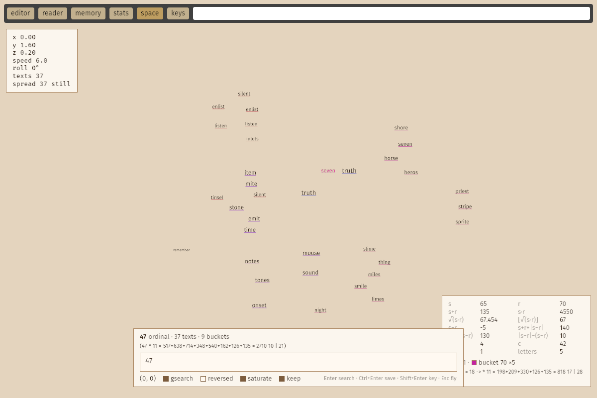
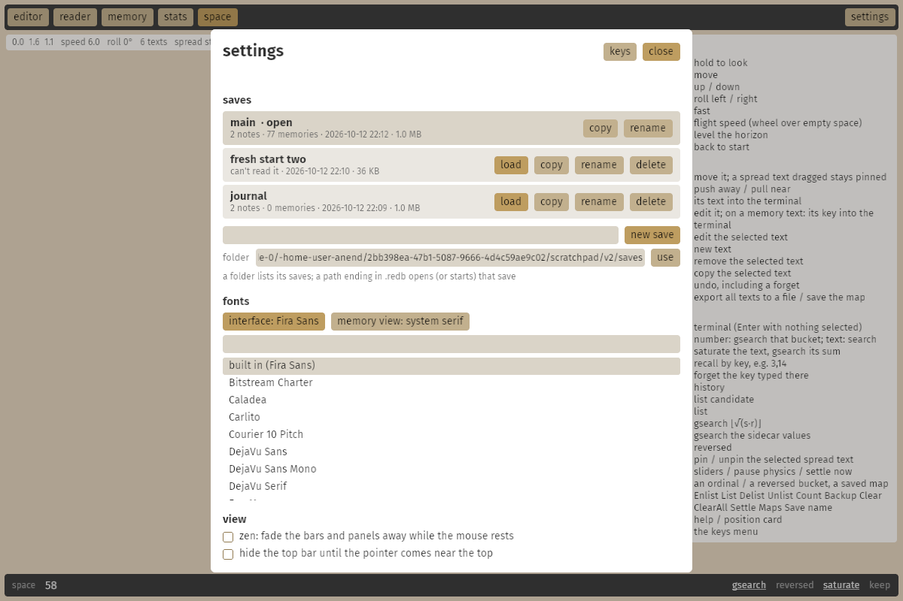

# anend

anend started out as a Go blog server: posts ("writs") in ArangoDB, magic-link email
logins, and a sand-coloured admin panel for writing markdown. That server still lives
here (`main.go`, `backend/`, `assets/`, `templates/`), now on modern Go with an embedded
database; see [the old server](#the-old-server).

**anend notes** is its Rust successor: a desktop markdown note app with no server. It
keeps the admin panel's look and workflow, and is built with
[Bevy 0.20](https://bevy.org)'s feathers widgets. Notes are stored locally in an
embedded [redb](https://www.redb.org) (4.3) database, and you can keep several of them
as saves and swap between them like a game's.





## Using it

| | |
|---|---|
| **editor** | the note list (with **+ new**) next to the editor card. The first `# line` is the note's title, the rest is markdown. |
| **tags** | type a tag in the box at the top of the card and press Enter (or `,`); click a tag to remove it |
| **published** | ticking it saves the note and shows it in the reader |
| **view / edit** | switch between the markdown source and the rendered note |
| **reader** | published notes, newest first, the way the old front page listed writs; click a `#tag` to filter |
| **stats** | counts of notes, words, saves and tags |
| **memory** | weum's memory view: short texts ("memories") and your notes, searched by gematria or by words |
| **command bar** | the line at the bottom, one for every view (see below) |
| **space** | weum's spatial memory (remem): fly through a room where memory texts float, laid out by their sums |
| **settings** | saves, fonts, zen mode and the top bar (also **Ctrl+,**); the key remap menu is in there too (also **K**, or **Ctrl+K** in the space) |

Shortcuts: **Ctrl+S** save, **Ctrl+N** new note, **Ctrl+E** toggle view/edit,
**Ctrl+1..5** editor / reader / memory / stats / space, **Ctrl+,** settings, **/** the
command bar. All of them can be changed in **keys**.

Unsaved changes (marked `•` in the list) are saved when you switch notes or close the
window. A note needs a `# title` before it can be saved.

## The command bar

There's one place to type, the bar at the bottom, and it does what the view you're in
needs. Its name at the left says which; each view keeps its own text, so switching views
doesn't lose what you typed.

| view | the bar | at its right |
|---|---|---|
| editor, reader, stats | finds notes: the list (and the reader) narrow to notes with words starting with what you type; Enter opens the first | how many notes match |
| memory | weum's term bar (below) | the sidecar of the term's sums, the buckets, the toggles |
| space | the space's terminal (below) | the terminal's sums and the chips |

**/** goes to the bar, **Escape** leaves it.

## Saves and settings

Every database is a save. **settings** lists the saves in your saves folder, the open one
first and then the most recently used, each with its notes, memories, date and size:
**load** one (the open note is saved first), start a **new save** by name, **copy**,
**rename** (the open one too) or **delete** one (not the open one, and only after a
second click). The folder box changes the saves folder; a path ending in `.redb` there
opens (or starts) that file instead. The app comes back to the save you had open.

Also in settings:

| | |
|---|---|
| **fonts** | the interface font (every text in the app, the space's floating texts too) and the memory view's font, from the fonts on your system; filter the list by typing |
| **zen** | while the mouse rests the bars and panels fade away (after 1, 2.5, 5 or 10 seconds); typing in the editor doesn't bring them back, moving the mouse does |
| **hide the top bar** | it slides up out of the way and back down when the pointer comes to the top edge |

These settings and your key bindings live in `config.json` in the platform config folder
(`~/.config/anend` on Linux, `~/Library/Application Support/anend` on macOS,
`%APPDATA%\anend` on Windows), not in a save, so they stay the same whichever save is
open. `ANEND_CONFIG` points it somewhere else.

## Memory and gsearch

The memory view is weum's `memory.html`, without the browser. Type in the command bar;
the sidecar at its right shows the term's four gsearch keys:

| bucket | measure |
|---|---|
| ordinal | a=1 .. z=26 |
| reversed | a=26 .. z=1 |
| atbash | every letter swapped for its mirror in its alphabet, `n + 1 − v`: a=26 .. z=1 for Latin (the reversed value), α=24 .. ω=1 for Greek, א=22 .. ת=1 for Hebrew |
| frequency | the letter frequency table, so anagrams share a bucket (shown as the sorted letters, `eilnst`) |

**Term bar**

| | |
|---|---|
| Enter on a number | gsearch it in the current bucket, under its prime factor reduction line (weum's `pfR`, numbers clickable) |
| Enter on text | gsearch the text's key in the current bucket and show the text itself, saving it as a memory when it's new. With gsearch-typed-text off (**G**): an ordinary word search over every variation weum's search tries (case, plurals, suffixes) |
| Ctrl+Enter | gsearch the text and save it |
| Shift+Enter | show the item under a key (`3,4`, or `note:1000001`) |
| Delete | forget the memory under the key typed |
| `Enlist` `List` `Delist` `Unlist` | list commands, using the list and candidate picked below |
| Escape | leave the term bar so the single keys work (**/** goes back) |

**Results**: click puts a text in the term bar, double-click its key, Ctrl+click picks it
as list candidate, Shift+click as the list, Ctrl+right-click forgets it and saves it again
under a new key, middle-click opens a note. Hovering shows weum's gsum line (sums,
difference, vowels, consonants, words, atbash).

**Underlines**: a text that shares its reversed sum with any other text is underlined in
a colour taken from its reversed sum (all its matches share the hue) and ordinal sum (the
shade). Texts alone with their reversed sum get none.

**Single keys** (outside text boxes): **O** / **R** / **A** / **F** pick the bucket (**R**
again goes back to ordinal), **←** **→** **↑** **↓** gsearch the term's ordinal /
reversed / atbash / letters, **G** gsearch typed text, **S** save searches as memories,
**W** white mode. The buckets and toggles also sit at the bar's right, to click.

To bring weum's memories over, back them up there (`memory.backup` writes
`all-of-it.json`) and run

```sh
anend --import-weum all-of-it.json
```

They keep their keys, and new memories continue weum's key allocation (one byte keys,
then two, three and four, reusing forgotten ones). Images and embedding search (esearch)
from weum aren't part of the app.

## The space

The space is remem (kuis), weum's spatial memory, as a view of the app. Memory texts
float in a warm room as camera-facing billboards, drawn as GPU vector text with
[bevy_slugtext](https://github.com/SaulDoesCode/bevy_slugtext). A gsearch pulls its
bucket's memories in and spread lays them out in front of you: each bucket (texts with
the same reversed sum, or ordinal with **reversed** on) clusters on an Archimedean spiral
by its sum, deeper the higher the sum, with texts repelling each other (more so when one
isn't the other's atbash). Texts sharing a bucket are underlined in its colour.

**Flying**: hold the right mouse button to look, **W A S D** move, **Space** / **C** up and
down, **Q** / **E** roll, **Shift** fast, **[** **]** or the wheel over empty space change
the speed, **R** levels the horizon, **Home** goes back to the start.

**Texts**: drag one to move it (a spread text you move stays pinned, **U** toggles that),
the wheel on a text pushes it away or pulls it near, click puts its text in the terminal,
double click edits it (a memory text: its key into the terminal), double click on empty
space or **N** makes a new text, **Enter** edits the selected one, **Delete** removes it,
**Ctrl+C** copies it, **Ctrl+Z** undoes (a forget too). Ctrl+click picks a list candidate,
Shift+click the list, Ctrl+right click gsearches ⌊√(s·r)⌋. Hovering shows its metrics
card: s, r, their sums, product, roots and differences, vowels, consonants, words, its
key and bucket, every number gsearching itself.

**Terminal**, the command bar in the space (**/**, or **Enter** with nothing selected; it
says "editing" while you edit a text in it): a number gsearches that bucket,
text gsearches its sum (with **gsearch** off, searches its words), **Ctrl+Enter**
saturates the text and gsearches its sum, **Shift+Enter** recalls a key, **Delete**
forgets the key typed, **↑** **↓** walk the history, **Esc** goes back to flying. `#123`,
`#r123` and `#name` go to an ordinal bucket, a reversed one or a saved map. The words
`Enlist` `List` `Delist` `Unlist` `Count` `Backup` `Clear` `ClearAll` `Settle` `Maps` and
`Save name` are commands. The chips at its right: **gsearch**, **reversed** (**F**),
**saturate** (searches save new texts) and **keep** (new results join the spread instead
of replacing it).

**More keys**: **O** the spread's sliders, **P** pauses the physics, **K** settles it now,
**←** **→** gsearch the terminal's sums, **X** exports every text to a JSON file in your
Downloads, **Shift+X** saves the map in the database (**Maps** lists them), **H** help,
**I** the position card. Every key can be remapped in **keys**. weum's esearch, speech
and image memories aren't part of it.

## Building

```sh
cargo run --release
```

Bevy 0.20 needs Rust 1.97.1 or newer. On Linux you also need the usual Bevy system
packages, e.g. on Debian/Ubuntu: `libwayland-dev libxkbcommon-dev` (plus
`libxkbcommon-x11-0` at runtime on X11). The memory view uses a system serif font
(Times New Roman, or whatever serif fontconfig offers).

The tokenizer, the gematria sums and the frequency table have AVX2 kernels picked at
runtime on x86_64, with scalar fallbacks elsewhere.

## Data

A save holds the notes, the memories, the search tables and the space's maps and
settings. Saves go in the saves folder, by default the platform data directory
(`~/.local/share/anend` on Linux, `~/Library/Application Support/anend` on macOS,
`%APPDATA%\anend` on Windows), starting with `notes.redb`; settings can move it.
`--db <file>` opens a particular save for one run.

To bring writs over from the old server, export the `writs` collection (for example
`arangoexport --collection writs --type json`) and import it:

```sh
anend --import writs.json
```

This keeps their keys, titles, markdown, tags, dates, edit history and published
(`public`) state.

## The old server

The Go server still runs: the front page, writ pages, the admin panel and its editor,
looking the way they did. ArangoDB is gone; everything sits in one
[bbolt](https://github.com/etcd-io/bbolt) file. It needs Go 1.26 or newer (an older `go`
fetches a newer toolchain by itself).

```sh
go build -o anend-server .
./anend-server -admin you@example.com
```

That makes you an admin (creating the user if needed, with a username taken from the
email, or `-admin-name`) and prints a login link. Open it and you land in `/admin`. The
site is at `http://localhost:8080`; `-addr` changes where it listens and `-url` the
address put in links, when it sits behind a proxy.

Logging in works like before, with a username and email in the form on the front page,
but the magic link is printed in the server's terminal instead of emailed:

```
2026/10/13 04:18:32 login link for saul <saul@example.com> (good for 15m0s, once):

    http://localhost:8080/auth/Xq3v...a-long-random-token...k9E
```

A link works once, within 15 minutes, and logs you in for a week. Run with
`-admin you@example.com` again whenever you need a fresh one. To email links instead, give
it an SMTP server: `-smtp mail.example.com:587 -smtp-user you -smtp-from you@example.com`,
with the password in `ANEND_SMTP_PASSWORD`. If sending fails the link is printed anyway.

The data lives in `data/anend.db` (`-db` puts it elsewhere): writs, users, and
sessions, the last stored only as hashes of the cookies. Back it up by copying the file
while the server is stopped.

To bring writs over from the ArangoDB days, use the same export as for the app:

```sh
./anend-server -import writs.json
```

It reads arangoexport's json or jsonl, keeps keys, slugs, dates, edit history, views and
the `public` flag, renders the markdown again and exits. Importing twice replaces rather
than duplicates.

Other flags: `-dev` reads `assets/` and `templates/` from disk (otherwise they're built
into the binary) and logs every request, `-tls-cert`/`-tls-key` serve https directly,
`-no-ratelimit` turns off the login request limits. `go test ./...` runs the store tests
and a login-to-published-writ run through the http api.

## Layout

| file | what |
|---|---|
| `src/main.rs` | startup, command line, window |
| `src/ui.rs` | the interface: layout scenes, actions, rebuild systems, markdown rendering |
| `src/theme.rs` | the sand palette from `admin.css` as a feathers theme |
| `src/note.rs` | the note model, title/body splitting, dates |
| `src/store.rs` | redb storage |
| `src/markdown.rs` | markdown to styled text blocks |
| `src/simd.rs` | AVX2 tokenizer, gematria dual sum (ordinal, reversed, atbash) and letter frequencies |
| `src/memory.rs` | the memory and search tables: weum's allocator, token index, the four gsearch buckets, lists |
| `src/weum.rs` | ports of memory.js helpers: pfR, the gsum line, the search variations |
| `src/memory_ui.rs` | the memory view |
| `src/keys.rs` | actions, bindings and the remap logic |
| `src/spread.rs` | spread.js: the layout of memory texts by their sums, checked step by step against the original |
| `src/space.rs` | the space: flying, the texts as slug billboards, picking, the terminal's memory commands, maps |
| `src/space_ui.rs` | the space's panels: position line, help, metrics, sliders, search line |
| `src/bar.rs` | the command bar every view shares |
| `src/settings.rs` | the settings menu and the saves: load, new, copy, rename, delete |
| `src/config.rs` | the settings file |
| `src/typeface.rs` | swapping the interface font and the memory view's font |
| `src/zen.rs` | zen's fade and the hiding top bar |
