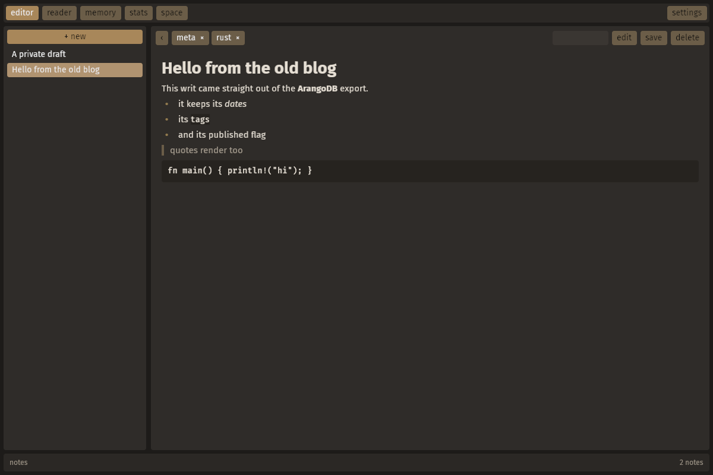

# anend

anend started out as a Go blog server: posts ("writs") in ArangoDB, magic-link email
logins, and a sand-coloured admin panel for writing markdown. Both halves are Rust now.

**anend notes** is its Rust successor: a desktop markdown note app with no server. It
keeps the admin panel's look and workflow, and is built with
[Bevy 0.20](https://bevy.org)'s feathers widgets. Notes are stored locally in an
embedded [redb](https://www.redb.org) (4.3) database, and you can keep several of them
as saves and swap between them like a game's.

**anend hub** is what became of the server: a self-hosted place to share saves, the way a
game has a workshop or a mod hub. People join, share their saves, star and download each
other's, and earn points, levels and badges when others use what they made; the app
browses and shares straight from its settings. See [the hub](#the-hub).




## Using it

| | |
|---|---|
| **editor** | the note list (with **+ new**) next to the editor card. The first `# line` is the note's title, the rest is markdown. **‹** (or **Ctrl+B**) slides the list away to the left; it peeks back out while the pointer is at the left edge. |
| **tags** | type a tag in the box at the top of the card and press Enter (or `,`); click a tag to remove it |
| **view / edit** | switch between the markdown source and the rendered note |
| **reader** | your notes, newest first, the way the old front page listed writs; click a `#tag` to filter |
| **stats** | counts of notes, words, saves and tags |
| **memory** | weum's memory view: short texts ("memories") and your notes, searched by gematria or by words |
| **command bar** | the line at the bottom, one for every view (see below) |
| **space** | weum's spatial memory (remem): fly through a room where memory texts float, laid out by their sums |
| **settings** | saves, fonts, colours, sizes, zen mode and the bars (also **Ctrl+,**); the key remap menu is in there too (also **K**, or **Ctrl+K** in the space) |

Shortcuts: **Ctrl+S** save, **Ctrl+N** new note, **Ctrl+E** toggle view/edit, **Ctrl+B** the note list,
**Ctrl+1..5** editor / reader / memory / stats / space, **Ctrl+,** settings, **/** the
command bar. All of them can be changed in **keys**.

Unsaved changes (marked `•` in the list) are saved when you switch notes or close the
window. A note needs a `# title` before it can be saved.

## The command bar

There's one place to type, the bar at the bottom, and it does what the view you're in
needs. Its name at the left says which; each view keeps its own text, so switching views
doesn't lose what you typed.

| view | the bar | at its right |
|---|---|---|
| editor, reader, stats | finds notes: the list (and the reader) narrow to notes with words starting with what you type; Enter opens the first | how many notes match |
| memory | weum's term bar (below) | the sidecar of the term's sums, the buckets, the toggles |
| space | the space's terminal (below) | the terminal's sums and the chips |

**/** goes to the bar, **Escape** leaves it.

## Saves and settings

Every database is a save. **settings** lists the saves in your saves folder, the open one
first and then the most recently used, each with its notes, memories, date and size:
**load** one (the open note is saved first), start a **new save** by name, **copy**,
**rename** (the open one too) or **delete** one (not the open one, and only after a
second click). The folder box changes the saves folder; a path ending in `.redb` there
opens (or starts) that file instead. The app comes back to the save you had open.

Also in settings:

| | |
|---|---|
| **fonts** | the interface font (every text in the app, the space's floating texts too) and the memory view's font, from the fonts on your system; filter the list by typing |
| **zen** | while the mouse rests the bars and panels fade away (after 1, 2.5, 5 or 10 seconds); typing in the editor doesn't bring them back, moving the mouse does |
| **colours** | every colour the app uses has a name (window, bars, bar text, cards, writing pad, buttons, accent, text, links, code, the space's room...): pick one and set it with the hue, saturation and lightness sliders or a hex. **sand** (the old admin panel's), **night**, **paper** and **sea** are starting points; **reset** puts one colour back. The memory view keeps weum's own colours |
| **sizes** | the whole interface's scale, and the top bar's and command bar's heights in pixels, the way a desktop panel is set; their text and buttons are sized to fit |
| **hide the top bar** | it slides up out of the way and back down when the pointer comes to the top edge |
| **slide the note list away** | the same as **Ctrl+B**: it stays away until the pointer comes to the left edge |
| **the space's search line** | in the space, what was searched, its counts and its sum's prime factor chain sit in the top bar (fading with it under zen); this turns that off |

**hub**, in settings, under the saves: give it a hub's address and an app token (made on
your page on the hub) and connect. Browse the hub's saves (search, and sort by new, stars,
downloads or featured) and **download** one: it's checked, then lands in your saves
folder, ready to load. **Share this save** sends the open one with a name, description and
tags. The app only ever talks to the hub you give it, on a background thread.

These settings and your key bindings live in `config.json` in the platform config folder
(`~/.config/anend` on Linux, `~/Library/Application Support/anend` on macOS,
`%APPDATA%\anend` on Windows), not in a save, so they stay the same whichever save is
open. `ANEND_CONFIG` points it somewhere else.

## Memory and gsearch

The memory view is weum's `memory.html`, without the browser. Type in the command bar;
the sidecar at its right shows the term's four gsearch keys:

| bucket | measure |
|---|---|
| ordinal | a=1 .. z=26 |
| reversed | a=26 .. z=1 |
| atbash | every letter swapped for its mirror in its alphabet, `n + 1 − v`: a=26 .. z=1 for Latin (the reversed value), α=24 .. ω=1 for Greek, א=22 .. ת=1 for Hebrew |
| frequency | the letter frequency table, so anagrams share a bucket (shown as the sorted letters, `eilnst`) |

**Term bar**

| | |
|---|---|
| Enter on a number | gsearch it in the current bucket, under its prime factor reduction line (weum's `pfR`, numbers clickable) |
| Enter on text | gsearch the text's key in the current bucket and show the text itself, saving it as a memory when it's new. With gsearch-typed-text off (**G**): an ordinary word search over every variation weum's search tries (case, plurals, suffixes) |
| Ctrl+Enter | gsearch the text and save it |
| Shift+Enter | show the item under a key (`3,4`, or `note:1000001`) |
| Delete | forget the memory under the key typed |
| `Enlist` `List` `Delist` `Unlist` | list commands, using the list and candidate picked below |
| Escape | leave the term bar so the single keys work (**/** goes back) |

**Results**: click puts a text in the term bar, double-click its key, Ctrl+click picks it
as list candidate, Shift+click as the list, Ctrl+right-click forgets it and saves it again
under a new key, middle-click opens a note. Hovering shows weum's gsum line (sums,
difference, vowels, consonants, words, atbash).

**Underlines**: a text that shares its reversed sum with any other text is underlined in
a colour taken from its reversed sum (all its matches share the hue) and ordinal sum (the
shade). Texts alone with their reversed sum get none.

**Single keys** (outside text boxes): **O** / **R** / **A** / **F** pick the bucket (**R**
again goes back to ordinal), **←** **→** **↑** **↓** gsearch the term's ordinal /
reversed / atbash / letters, **G** gsearch typed text, **S** save searches as memories,
**W** white mode. The buckets and toggles also sit at the bar's right, to click.

To bring weum's memories over, back them up there (`memory.backup` writes
`all-of-it.json`) and run

```sh
anend --import-weum all-of-it.json
```

They keep their keys, and new memories continue weum's key allocation (one byte keys,
then two, three and four, reusing forgotten ones). Images and embedding search (esearch)
from weum aren't part of the app.

## The space

The space is remem (kuis), weum's spatial memory, as a view of the app. Memory texts
float in a warm room as camera-facing billboards, drawn as GPU vector text with
[bevy_slugtext](https://github.com/SaulDoesCode/bevy_slugtext). A gsearch pulls its
bucket's memories in and spread lays them out in front of you: each bucket (texts with
the same reversed sum, or ordinal with **reversed** on) clusters on an Archimedean spiral
by its sum, deeper the higher the sum, with texts repelling each other (more so when one
isn't the other's atbash). Texts sharing a bucket are underlined in its colour.

**Flying**: hold the right mouse button to look, **W A S D** move, **Space** / **C** up and
down, **Q** / **E** roll, **Shift** fast, **[** **]** or the wheel over empty space change
the speed, **R** levels the horizon, **Home** goes back to the start.

**Texts**: drag one to move it (a spread text you move stays pinned, **U** toggles that),
the wheel on a text pushes it away or pulls it near, click puts its text in the terminal,
double click edits it (a memory text: its key into the terminal), double click on empty
space or **N** makes a new text, **Enter** edits the selected one, **Delete** removes it,
**Ctrl+C** copies it, **Ctrl+Z** undoes (a forget too). Ctrl+click picks a list candidate,
Shift+click the list, Ctrl+right click gsearches ⌊√(s·r)⌋. Hovering shows its metrics
card: s, r, their sums, product, roots and differences, vowels, consonants, words, its
key and bucket, every number gsearching itself.

**Terminal**, the command bar in the space (**/**, or **Enter** with nothing selected; it
says "editing" while you edit a text in it): a number gsearches that bucket,
text gsearches its sum (with **gsearch** off, searches its words), **Ctrl+Enter**
saturates the text and gsearches its sum, **Shift+Enter** recalls a key, **Delete**
forgets the key typed, **↑** **↓** walk the history, **Esc** goes back to flying. `#123`,
`#r123` and `#name` go to an ordinal bucket, a reversed one or a saved map. The words
`Enlist` `List` `Delist` `Unlist` `Count` `Backup` `Clear` `ClearAll` `Settle` `Maps` and
`Save name` are commands. The chips at its right: **gsearch**, **reversed** (**F**),
**saturate** (searches save new texts) and **keep** (new results join the spread instead
of replacing it).

**More keys**: **O** the spread's sliders, **P** pauses the physics, **K** settles it now,
**←** **→** gsearch the terminal's sums, **X** exports every text to a JSON file in your
Downloads, **Shift+X** saves the map in the database (**Maps** lists them), **H** help,
**I** the position card. Every key can be remapped in **keys**. weum's esearch, speech
and image memories aren't part of it.

## Downloads

Builds for Linux and Windows are on the repository's
[releases page](https://github.com/SaulDoesCode/anend/releases), each with the app
(`anend`) and the hub (`anend-hub`). On Linux the app needs the Wayland or X11
libraries a desktop already has.

They're made by GitHub Actions (`.github/workflows/release.yml`). To make a release, tag a
commit and push the tag:

```sh
git tag v0.2.0
git push origin v0.2.0
```

The workflow builds both on Linux and Windows and attaches a `.tar.gz` and a
`.zip` to a new release named after the tag, with notes listing the merged pull requests.
**Run workflow** on the repository's Actions tab (release) builds the same packages as
downloadable artifacts without making a release. `.github/workflows/ci.yml` checks
formatting, clippy and the tests of both on every push to master and every pull request.

## Building

```sh
cargo run --release
```

Bevy 0.20 needs Rust 1.97.1 or newer. On Linux you also need the usual Bevy system
packages, e.g. on Debian/Ubuntu: `libwayland-dev libxkbcommon-dev libfontconfig1-dev` (plus
`libxkbcommon-x11-0` at runtime on X11). The memory view uses a system serif font
(Times New Roman, or whatever serif fontconfig offers).

The tokenizer, the gematria sums and the frequency table have AVX2 kernels picked at
runtime on x86_64, with scalar fallbacks elsewhere.

## Data

A save holds the notes, the memories, the search tables and the space's maps and
settings. Saves go in the saves folder, by default the platform data directory
(`~/.local/share/anend` on Linux, `~/Library/Application Support/anend` on macOS,
`%APPDATA%\anend` on Windows), starting with `notes.redb`; settings can move it.
`--db <file>` opens a particular save for one run.

To bring writs over from the old server, export the `writs` collection (for example
`arangoexport --collection writs --type json`) and import it:

```sh
anend --import writs.json
```

This keeps their keys, titles, markdown, tags, dates and edit history.

## The hub


`anend-hub` (in `hub/`, built with [Salvo](https://salvo.rs)) is a website and an API for
sharing saves. Start one and make yourself its admin:

```sh
cargo run --release -p anend-hub -- --admin yourname
```

It prints a login link (good once, within an hour); open it and set a password on your
page. The hub listens on `127.0.0.1:8080` and keeps everything in `./hub-data`: its own
redb database (people, sessions, saves' details, stars) and the save files in
`hub-data/saves/`. Back it up by copying the folder while the hub is stopped.

**What's in it**

| | |
|---|---|
| **the grid** | every shared save as a card, headed by its name's ordinal and reversed sums in a colour taken from them; search by words, author or `#tag`, sort by new, stars, downloads or featured |
| **a save's page** | its description and tags, some of its memories with their sums, its notes' titles, stars, downloads, and the download |
| **joining** | name and password (email optional). By default it's an application an admin answers; `--open` lets people straight in |
| **sharing** | upload a `.redb` save with a name, description and tags. The hub opens its own copy to check it's a save the app made (a copy of an open save is fine) and reads its counts and memories. It waits for an admin unless you're trusted; a new version keeps its stars and downloads |
| **the game** | points when others use what you share: 50 when a save is let in, 5 a star, 1 for each person who downloads it, 100 when it's featured, and 1 for each save you star. Levels go seeker, reader, scribe, counter, cipherer, numerologist, gematrian, archivist, palace keeper, sage; badges for milestones (first save, prolific, beloved, well read, library, memory palace, curator, founder...). Stars and downloads count once per person, and your own don't count |
| **people** | a page each, with level, badges, saves and a bio; the leaderboard ranks them, and the most starred saves |
| **admin** | saves waiting (let in, or turn down with a reason), people applying, everyone (member, trusted (no review), admin, ban, make a login link), and every save (approve, turn down, feature, remove) |
| **app tokens** | made on your page and pasted into the app (settings → hub), which uses them to share (see [the API](docs/hub-api.md)) |

**Options**: `--addr` where it listens, `--url` the address people reach it at (for login
links, and https cookies when it starts with `https://`), `--data` its folder, `--name` and
`--about` what it calls itself, `--open`, `--max-upload` in MB (64), `--behind-proxy` to
trust `X-Forwarded-For`, `--no-ratelimit`. It speaks plain http: put it behind a reverse
proxy (Caddy, nginx) for https.

Passwords are hashed with argon2; sessions and tokens are random and stored only as
hashes; forms posted from other sites are refused; logins, joins and uploads are limited
per address.

## Layout

| file | what |
|---|---|
| `src/main.rs` | startup, command line, window |
| `src/ui.rs` | the interface: layout scenes, actions, rebuild systems, markdown rendering |
| `src/theme.rs` | the sand palette from `admin.css` as a feathers theme |
| `src/note.rs` | the note model, title/body splitting, dates |
| `src/store.rs` | redb storage |
| `src/markdown.rs` | markdown to styled text blocks |
| `src/simd.rs` | AVX2 tokenizer, gematria dual sum (ordinal, reversed, atbash) and letter frequencies |
| `src/memory.rs` | the memory and search tables: weum's allocator, token index, the four gsearch buckets, lists |
| `src/weum.rs` | ports of memory.js helpers: pfR, the gsum line, the search variations |
| `src/memory_ui.rs` | the memory view |
| `src/keys.rs` | actions, bindings and the remap logic |
| `src/spread.rs` | spread.js: the layout of memory texts by their sums, checked step by step against the original |
| `src/space.rs` | the space: flying, the texts as slug billboards, picking, the terminal's memory commands, maps |
| `src/space_ui.rs` | the space's panels: position line, help, metrics, sliders, search line |
| `src/bar.rs` | the command bar every view shares |
| `src/settings.rs` | the settings menu and the saves: load, new, copy, rename, delete |
| `src/config.rs` | the settings file |
| `src/typeface.rs` | swapping the interface font and the memory view's font |
| `src/zen.rs` | zen's fade, the hiding top bar and the sliding note list |
| `src/palette.rs` | the colours the settings change, and repainting the interface with them |
| `src/sizing.rs` | the interface scale and the bars' heights |
| `src/hub.rs` | talking to a hub: its API, downloads, uploads |
| `src/hub_ui.rs` | the hub section of the settings |
| `hub/src/main.rs` | the hub: command line and routes |
| `hub/src/hub.rs` | taking uploads in, finding saves, stars, downloads, reviews |
| `hub/src/store.rs` | the hub's redb tables |
| `hub/src/inspect.rs` | reading an uploaded save |
| `hub/src/game.rs` | points, levels and badges |
| `hub/src/auth.rs` | passwords, sessions, tokens, login links, rate limits |
| `hub/src/web.rs`, `hub/templates/` | the pages |
| `hub/src/api.rs` | the JSON API |
