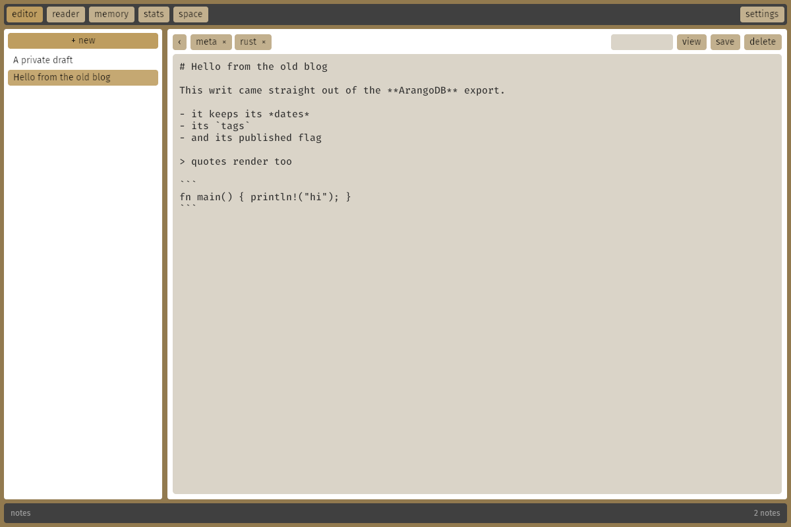
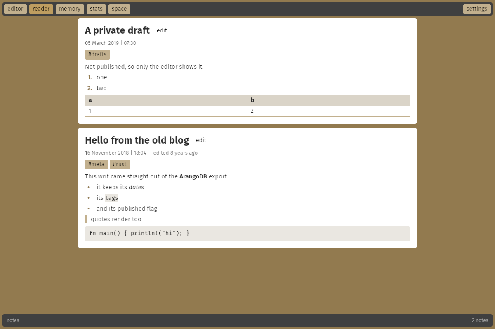
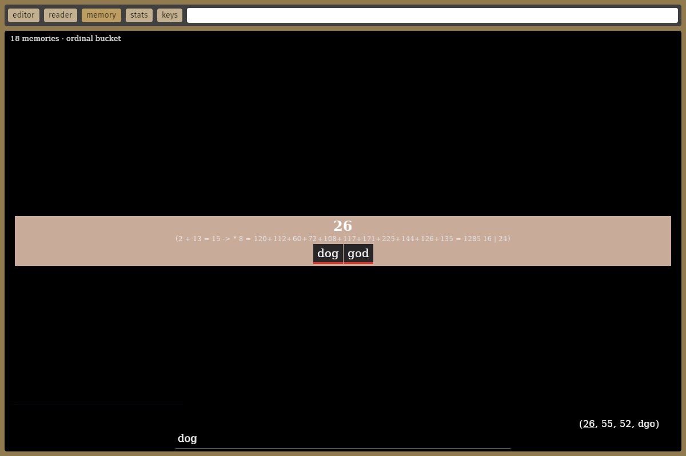

# anend

anend started out as a Go blog server: posts ("writs") in ArangoDB, magic-link email
logins, and a sand-coloured admin panel for writing markdown. That server still lives
here (`main.go`, `backend/`, `assets/`, `templates/`).

**anend notes** is its Rust successor: a desktop markdown note app with no server. It
keeps the admin panel's look and workflow, and is built with
[Bevy 0.20](https://bevy.org)'s feathers widgets. Notes are stored locally in an
embedded [redb](https://www.redb.org) database.





## Using it

| | |
|---|---|
| **editor** | the note list (with **+ new**) next to the editor card. The first `# line` is the note's title, the rest is markdown. |
| **tags** | type a tag in the box at the top of the card and press Enter (or `,`); click a tag to remove it |
| **published** | ticking it saves the note and shows it in the reader |
| **view / edit** | switch between the markdown source and the rendered note |
| **reader** | published notes, newest first, the way the old front page listed writs; click a `#tag` to filter |
| **stats** | counts of notes, words, saves and tags |
| **memory** | weum's memory view: short texts ("memories") and your notes, searched by gematria or by words |
| **search bar** | above the note list; filters notes to those with words starting with what you type |
| **keys** | the key remap menu (also **K**) |

Shortcuts: **Ctrl+S** save, **Ctrl+N** new note, **Ctrl+E** toggle view/edit,
**Ctrl+1..4** editor / reader / memory / stats. All of them can be changed in **keys**.

Unsaved changes (marked `•` in the list) are saved when you switch notes or close the
window. A note needs a `# title` before it can be saved.

## Memory and gsearch

The memory view is weum's `memory.html`, without the browser. Type in the term bar at
the bottom; the sidecar on the right shows the term's four gsearch keys:

| bucket | measure |
|---|---|
| ordinal | a=1 .. z=26 |
| reversed | a=26 .. z=1 |
| atbash | the planks' top side: every letter on a plank with the alphabet in squares, slid so the letter sits on the reading line; the squares above it, a=25 .. z=0 (the squares below, the letter included, are the ordinal) |
| frequency | the letter frequency table, so anagrams share a bucket (shown as the sorted letters, `eilnst`) |

**Term bar**

| | |
|---|---|
| Enter on a number | gsearch it in the current bucket, under its prime factor reduction line (weum's `pfR`, numbers clickable) |
| Enter on text | gsearch the text's key in the current bucket and show the text itself, saving it as a memory when it's new. With gsearch-typed-text off (**G**): an ordinary word search over every variation weum's search tries (case, plurals, suffixes) |
| Ctrl+Enter | gsearch the text and save it |
| Shift+Enter | show the item under a key (`3,4`, or `note:1000001`) |
| Delete | forget the memory under the key typed |
| `Enlist` `List` `Delist` `Unlist` | list commands, using the list and candidate picked below |
| Escape | leave the term bar so the single keys work (**/** goes back) |

**Results**: click puts a text in the term bar, double-click its key, Ctrl+click picks it
as list candidate, Shift+click as the list, Ctrl+right-click forgets it and saves it again
under a new key, middle-click opens a note. Hovering shows weum's gsum line (sums,
difference, vowels, consonants, words, atbash).

**Underlines**: a text that shares its reversed sum with any other text is underlined in
a colour taken from its reversed sum (all its matches share the hue) and ordinal sum (the
shade). Texts alone with their reversed sum get none.

**Single keys** (outside text boxes): **O** / **R** / **A** / **F** pick the bucket (**R**
again goes back to ordinal), **←** **→** **↑** **↓** gsearch the term's ordinal /
reversed / atbash / letters, **G** gsearch typed text, **S** save searches as memories,
**W** white mode. The toggles also sit bottom left, visible on hover.

To bring weum's memories over, back them up there (`memory.backup` writes
`all-of-it.json`) and run

```sh
anend --import-weum all-of-it.json
```

They keep their keys, and new memories continue weum's key allocation (one byte keys,
then two, three and four, reusing forgotten ones). Images and embedding search (esearch)
from weum aren't part of the app.

## Building

```sh
cargo run --release
```

Bevy 0.20 needs Rust 1.97.1 or newer. On Linux you also need the usual Bevy system
packages, e.g. on Debian/Ubuntu: `libwayland-dev libxkbcommon-dev` (plus
`libxkbcommon-x11-0` at runtime on X11). The memory view uses a system serif font
(Times New Roman, or whatever serif fontconfig offers).

The tokenizer, the gematria sums and the frequency table have AVX2 kernels picked at
runtime on x86_64, with scalar fallbacks elsewhere.

## Data

Notes, memories, the search tables and your key bindings are kept in `notes.redb` under
the platform data directory (`~/.local/share/anend` on Linux, `~/Library/Application Support/anend` on macOS,
`%APPDATA%\anend` on Windows). Use `--db <file>` to choose another file.

To bring writs over from the old server, export the `writs` collection (for example
`arangoexport --collection writs --type json`) and import it:

```sh
anend --import writs.json
```

This keeps their keys, titles, markdown, tags, dates, edit history and published
(`public`) state.

## Layout

| file | what |
|---|---|
| `src/main.rs` | startup, command line, window |
| `src/ui.rs` | the interface: layout scenes, actions, rebuild systems, markdown rendering |
| `src/theme.rs` | the sand palette from `admin.css` as a feathers theme |
| `src/note.rs` | the note model, title/body splitting, dates |
| `src/store.rs` | redb storage |
| `src/markdown.rs` | markdown to styled text blocks |
| `src/simd.rs` | AVX2 tokenizer, gematria dual sum (ordinal, reversed, atbash) and letter frequencies |
| `src/memory.rs` | the memory and search tables: weum's allocator, token index, the four gsearch buckets, lists |
| `src/weum.rs` | ports of memory.js helpers: pfR, the gsum line, the search variations |
| `src/memory_ui.rs` | the memory view |
| `src/keys.rs` | actions, bindings and the remap logic |
