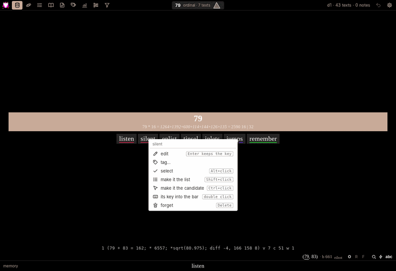
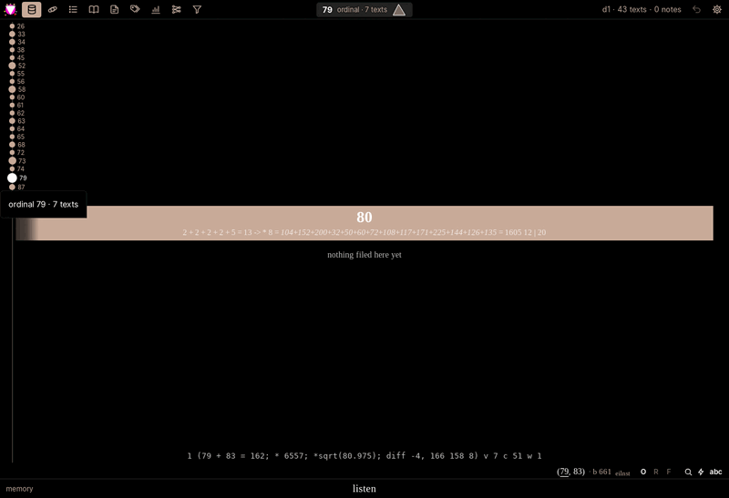
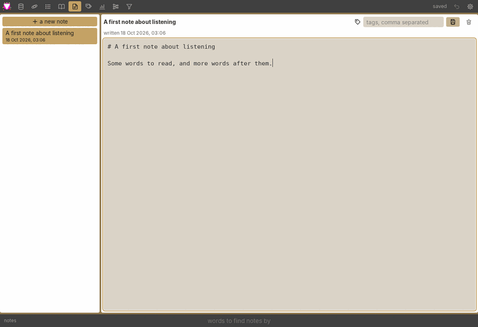
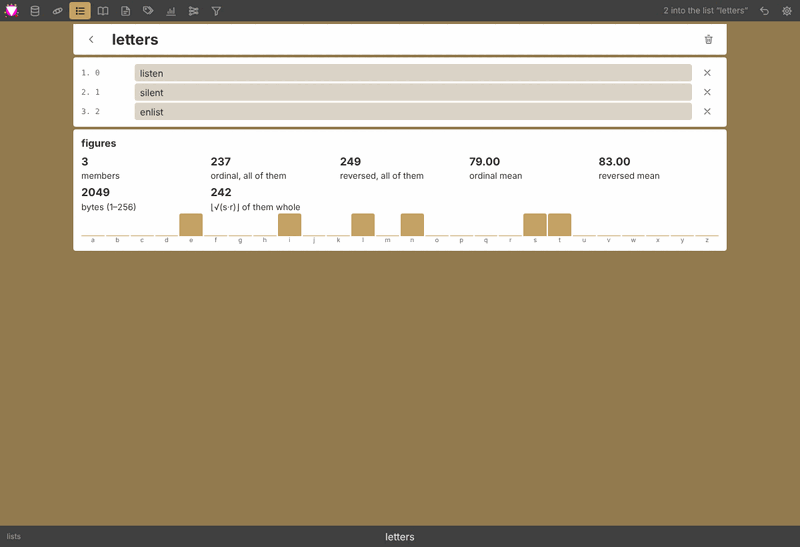
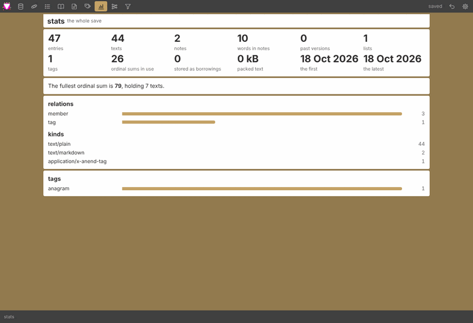
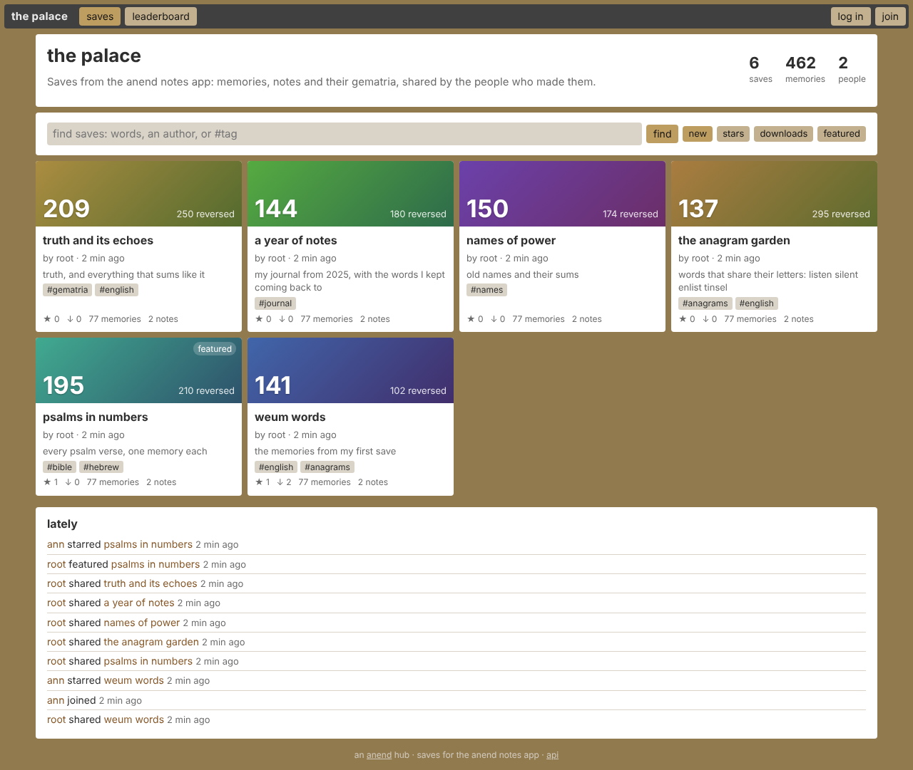

# anend

anend is a memory palace for short texts. You type a word or phrase and it is stored as
an entry with its gematria sums. You find it again by its numbers, its words, its tags or
the lists it's in, and you can fly through your memories laid out in space. It
continues [weum](docs/weum-reference/README.md), whose numbers it reproduces exactly.

It comes as:

- **the app** (`app/`, [Dioxus](https://dioxuslabs.com)): a desktop app, and the same
  app built to WebAssembly for the browser;
- **the hub** (`hub/`, [Salvo](https://salvo.rs)): a self-hosted server that runs the app
  for its members and serves it at `/app/`, and a place to share saves, like a game's
  workshop;
- **the core** (`core/`): what both share. That includes the entry graph store, gematria,
  the app's API, and a deterministic transformer engine for classifiers and generators.

| | |
|---|---|
|  |  |
| the memory view, with its menu | the space |
|  |  |
| sums as buckets | notes |
|  |  |
| the reader, night colours | a list's page (web) |
|  |  |
| stats (web) | filters (web) |

## The views

**Ctrl+1 … Ctrl+9** switch views, **Ctrl+,** opens settings, and **Esc** closes things.
Every view has the command bar at the bottom, and each view keeps its own text there.

| | |
|---|---|
| **memory** (Ctrl+1) | weum's memory view. **Enter** on text gsearches its sum and saves it when it's new. **Enter** on a number gsearches that bucket. **Ctrl+Enter** saves, **Shift+Enter** shows a key, **Delete** forgets. `Enlist` `List` `Delist` `Unlist` work on lists. **r / o / f** pick the bucket (reversed, ordinal, frequency), and **← →** gsearch the term's sums. Hover shows the gsum line, and texts that share a sum are underlined in its colour. The circles at the left edge are the buckets. **Alt+click** selects several texts to put in a list or tag. Right-click opens the menu: edit, tag, select, list, candidate, key, forget. |
| **space** (Ctrl+2) | memory texts floating in a room ([three.js](https://threejs.org)), laid out by their sums. Clicking a text puts its triangle in the top bar: sides s (ordinal), r (reversed) and ⌊√(s·r)⌋. The arrow keys glide to the nearest text in that direction, and its card opens on the right. |
| **lists** (Ctrl+3) | every list as a tile. A list's page has an editable name and members, and figures for the whole list: its sums, means, gsum and pfR chain. |
| **reader** (Ctrl+4) | everything that matches, in pages. Short texts appear as a tiny grid, and notes appear as markdown. |
| **notes** (Ctrl+5) | markdown notes, in a list by date, with tags and a read mode. A note can be attached to any entry. |
| **tags** (Ctrl+6) | tags on any entry: pick tags (all or any) and see the entries that have them. |
| **stats** (Ctrl+7) | figures for the whole save |
| **models** (Ctrl+8) | the outline of a model spec (inputs, heads, data, critics). For now it says "not yet": classifiers are being moved onto the spec. |
| **filters** (Ctrl+9) | words, a sum range, written between two dates, a tag, a kind. Each filter is kept by name in the save. |

The top bar holds the view icons, the search line with its triangle, undo (**Ctrl+Z**) and
settings. **Ctrl+= / Ctrl+−** zoom and **0** resets it.

**Settings** are a dialog with folding sections:
- colours (palettes, or your own) and the text size;
- the memory view's sizes and spacing, and the space's room colour;
- zen: the bars fade while you rest, and the top bar can hide until the pointer reaches
  the top edge;
- keys, and the hub (a hub's address, to browse and share);
- saves: open, new, copy, delete, **backup**, and **import from weum**.

## Saves

A save is one file, an entry graph in [redb](https://www.redb.org). Every text, note,
tag, list and setting is an entry with timestamps. Lists and tags are edges between
entries. Identical texts are stored once, and an entry can borrow another's text.
[docs/format.md](docs/format.md) describes the format. The desktop keeps saves in
`<data dir>/anend/saves/` (`~/.local/share/anend/saves` on Linux), and starts with `main`.

**Backup** writes `texts.json` (every text) and `other.json` (everything else) into the
save's `backups/` folder. **Import from weum** reads weum's `all-of-it.json` (made by
`memory.backup` in weum), and the texts keep their keys. Saves from older anend versions
aren't read.

Gematria modes are **ordinal** (a=1 … z=26), **reversed** (a=26 … z=1) and **frequency**
(the letters sorted, so anagrams share a bucket). Byte sums (bytes valued 1–256) are a
separate measure, in `core/src/measure.rs`.

## Building and running

```sh
# the desktop app (Linux needs libwebkit2gtk-4.1-dev and libxdo-dev)
cargo run --release -p anend-app

# the app for the browser: needs the wasm32-unknown-unknown target and wasm-bindgen-cli 0.2.129
app/web/build.sh            # writes app/web/dist

# a hub on your own machine: no logins, the app at http://127.0.0.1:8080/app/
cargo run --release -p anend-hub -- --local
```

Build the web app before the hub, so the hub can serve it at `/app/`. Without it,
`/app/` shows a page saying to run `app/web/build.sh`.

Before a change goes in, run the checks: `cargo fmt --all --check`,
`cargo clippy --workspace --all-targets -- -D warnings`, `cargo test --workspace`, and the
wasm build (`cargo build -p anend-app --target wasm32-unknown-unknown
--no-default-features --features web`). `.github/workflows/ci.yml` runs the same
checks, and `release.yml` builds the desktop app and the hub (with the web app inside)
for Linux and Windows when a `v*` tag is pushed.

## The hub



```sh
cargo run --release -p anend-hub -- --admin yourname
```

This prints a one-time login link. The hub keeps everything in `./hub-data`, and listens
on `127.0.0.1:8080`.
- **`--mode`** picks what it serves:
  - `hub`: the sharing site;
  - `app`: the web app for members, each with their own saves;
  - `both`: both, the default.
- **`--join`** sets how people get in: `invite`, `apply` or `open`.
- **Visibility:** each save is private, unlisted or public.

Members share saves, star and download each other's, and earn points, levels and badges
when others use what they made. The admin panel reviews saves and people.
[docs/deploy.md](docs/deploy.md) covers running one for real: modes, joining, TLS,
backups, Docker, and running it as a paid service. [docs/security.md](docs/security.md)
covers the security model.

The web app and the desktop make the same calls ([the app API](docs/app-api.md)), over
a WebSocket at `/app/ws` or `POST /app/api/{op}`. Anything that speaks JSON can drive
a save. [docs/hub-api.md](docs/hub-api.md) covers the sharing API.

## Models

`core/src/classify` is a transformer engine written from scratch: RMSNorm, SwiGLU, RoPE,
grouped key/value heads. The same inputs give the same output bits on any machine and
thread count. Models are described by a declarative spec ([docs/models.md](docs/models.md)):
- **inputs:** bytes, numbers, pictures, and optionally gematria channels (off unless you
  choose them);
- **heads:** classify, regress, and generate;
- **data queries**, and **critics:** classifiers that steer generation, by reranking,
  guidance or reinforcement.

**Pretrained models:** Llama-family checkpoints (Llama, Mistral, Qwen2/3, SmolLM) load
from safetensors and a `tokenizer.json`. Use `"from": {"pretrained": "<dir>"}` in a spec,
or see `core/examples/pretrained.rs`.

**The GPU:** an optional backend (`--features gpu`, wgpu) runs inference and training on
the GPU. It is bit-exact on a software GPU, and is turned on per run with
`"device": "gpu"`. `core/examples/gpu_bench.rs` measures it on your hardware.

[core/src/classify/STATUS.md](core/src/classify/STATUS.md) has the details and what's
measured.

## Layout

| | |
|---|---|
| `core/src/graph/` | the entry graph store: records, the 5-bit codec with references and calls, posting lists, edges, queries |
| `core/src/ops/` | the app API over a save and a folder of saves, merge and forge, shared by the desktop and the hub |
| `core/src/classify/` | the transformer engine, the spec, generation, pretrained import, the GPU backend |
| `core/src/measure.rs` | byte sums |
| `app/src/` | the Dioxus app: `shell.rs` (bars, keys, menu), `views/`, `backend/` (`local.rs` the graph in-process, `hub.rs` the WebSocket), `gem.rs` (weum's numbers), `space.js` |
| `app/web/` | the web build: `build.sh`, the page, its loader |
| `hub/src/` | the hub: modes, accounts, saves, sharing, the game, the app's API (`app.rs`, `appweb.rs`) |
| `docs/` | the formats, the APIs, deployment, security, models, and `next.md` (the plan and status) |
| `docs/weum-reference/` | weum's own code, the reference for its numbers |

[docs/guide.md](docs/guide.md) still describes the older apps in places, and will be
updated.
