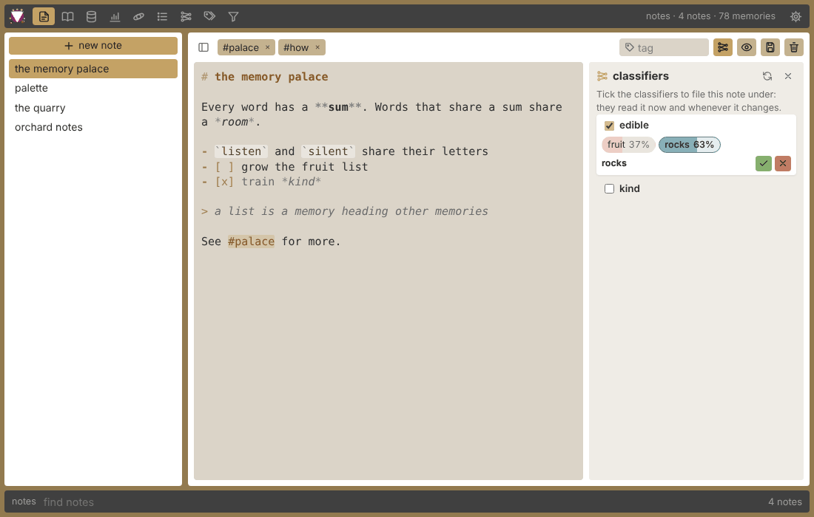
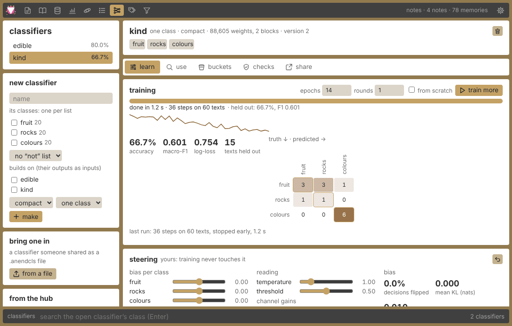
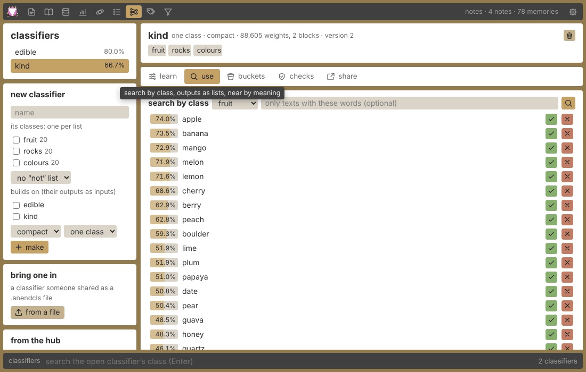
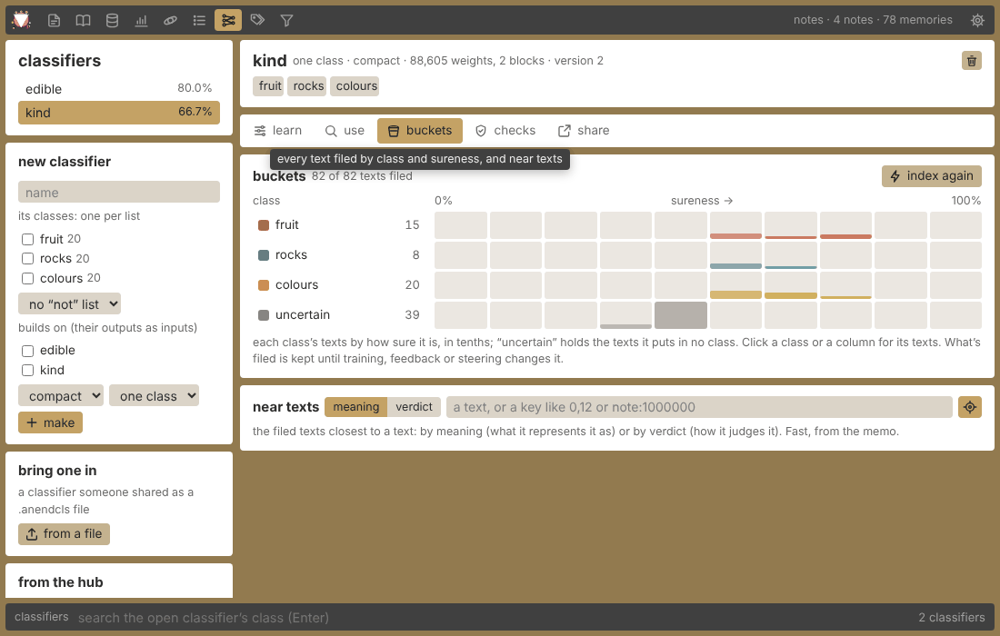

# The anend guide

What anend is, what each part of it does, and how to use it. For building it, running a
hub and the APIs, see the [README](../README.md).

## What anend is

anend is a notes app with a game inside it.

The **notes** side is plain: markdown notes with a `# title`, tags, a reader that lists
them like a blog, and saves you can swap between like a game's.

The **game** is a memory palace built on gematria. Every word or phrase you type has
sums, and texts that share a sum share a room:

| sum | how it counts | `plum` |
|---|---|---|
| **ordinal** | a=1, b=2 … z=26 | 62 |
| **reversed** | a=26, b=25 … z=1 | 46 |
| **atbash** | each letter swapped for its mirror in its alphabet (Latin, Greek or Hebrew); for Latin it's the reversed value | 46 |
| **letter frequency** | the letters themselves, sorted, so anagrams land together (`listen`, `silent` → `eilnst`) | `lmpu` |

You remember short texts ("memories"), find what shares their sums ("gsearch"), fly
through them in a 3D room, and gather them into **lists**. Then you grow lists into
**classifiers**: small models you train on your own lists, steer with your own sliders
and correct with a yes or a no. They are deterministic (the same save gives the same
answers on any machine, to the last bit), small enough to train in seconds, and they
are yours. Think of them as a personal, hand-grown alternative to the embeddings a
search engine would give you: you decide what goes together, and you can see why.

The **hub** is where people share what they make: saves and classifiers, with stars,
points, levels and badges for the things others use.

There are two apps, the same game in each:

- **the desktop app** (`anend`): a window of its own, everything kept on your computer.
- **the web app**: the same views in a browser, served by a hub (at `/app/`), or
  running offline from any web server with the saves kept in your browser.

Where they differ, this guide says so.

## Getting started

### The desktop app

Download `anend` for Linux or Windows from the
[releases page](https://github.com/SaulDoesCode/anend/releases) and run it. It opens on
the editor with an empty save called `notes`. There's nothing to set up: notes,
memories, lists and classifiers all live in that save, a file in your saves folder.

### The web app on a hub

Open a hub's address and choose **the app** in its top bar (or go straight to `/app/`).
On a shared hub you **join** (a name and a password; often an admin lets you in) and
**log in**; the app then keeps your saves on the hub, in a workspace of your own.

To have the web app just for yourself, run a hub on your own machine with no logins:

```sh
anend-hub --local
```

and open <http://127.0.0.1:8080/app/>.

### The web app offline

The web app also runs with no hub at all, from any static web server or with `?offline`
in its address. It does the sums itself, in the page, with the same answers as a hub,
and keeps its saves in your browser (IndexedDB). The top bar says "offline · in this
browser". Classifiers and filters need a hub for now; a save you bring offline keeps its
classifiers untouched for when it goes back.

Browser storage can be cleared, so export a bundle now and then
(see [moving saves around](#moving-saves-around)).

### The screen

Every view has the same frame:

- **the top bar**: the views as icons (hover for their names and shortcuts), a status
  line (the open save and its counts, or the last thing that happened), and settings.
- **the command bar** at the bottom: one place to type, which does what the view you're
  in needs. Its name on the left says which. Each view keeps its own text. **/** jumps
  to it, **Esc** leaves it.

## Notes



### The editor

The note list sits on the left (**+ new note** at its top), the note on the right.

- The first line, `# like this`, is the note's **title**; the rest is markdown. A note
  needs a title before it can be saved.
- **Ctrl+S** saves, **Ctrl+N** starts a new note, **Ctrl+E** switches between the source
  and the rendered note. Changes you haven't saved are marked `•` in the list, and are
  saved when you switch notes or close the window.
- **Ctrl+B** (or the sidebar button) slides the note list away; it peeks back while the
  pointer is at its edge.
- **Tags**: type one in the tag box and press Enter or a comma. Click a tag to remove it.
- **Highlighting**: headings, emphasis, code, links, list markers, task boxes, quotes and
  `#tags` are coloured as you type. The desktop app can turn it off in settings.
- **Finding notes**: type in the command bar; the list narrows to notes with words
  starting with what you typed. Enter opens the first.
- The trash button deletes the note (click twice on the web, it asks first on the
  desktop).

**The classifiers drawer** (the classifier button by view/save, **Ctrl+I** on the web)
shows which classifiers this note is filed under. Tick one and it reads the note now and
whenever it changes; its verdict shows as chips, one per class, each with how sure it
is. The classes it counts the note in are filled in. ✓ and ✗ tell it whether its top
class is right, which teaches it on the spot (see [feedback](#teaching-it-yes-and-no)).
A note has to be saved once before it can be filed.

### The reader

Every note, newest first, rendered, the way a blog's front page lists posts. Click a
`#tag` to keep to that tag, and the pencil to edit a note. The command bar finds notes
here too.

### Tags

Every tag with how many notes have it.

- Type in the command bar to find a tag; **Enter** picks the first match and clears the
  bar, so you can pick tag after tag. **Backspace** on an empty bar drops the last one.
- Click a tag to pick it; Ctrl- or Shift-click adds or removes it alongside the others.
- **all** shows notes with every picked tag; **any**, notes with at least one.
- The notes found are listed beside, with a preview; click one to open it in the editor.
- Stats' tags open this view too.

### Stats

Counts: notes, words, how many times you've saved (each edit counts), memories and tags,
and the dates of your first and latest notes. Click a tag to open it in the tags view.

## Memories and gsearch


The memory view is a black page with the results in a band in the middle. You work it
from the command bar.

### Searching

| type | press | what happens |
|---|---|---|
| a word or phrase | **Enter** | it's remembered (when it's new and **saturate** is on) and everything sharing its sum in the current bucket comes up |
| a number | **Enter** | that bucket's texts come up, with the number's prime factor chain under it (each number in the chain is clickable) |
| a key like `0,12` or `note:1000001` | **Shift+Enter** | that one memory or note |
| a text | **Ctrl+Enter** | gsearch it and remember it, whatever the toggles say |
| a memory's key | **Delete** (at the end of the bar) | forget that memory |

While you type, the bar's right side shows the text's four keys, `(ordinal, reversed,
atbash, letters)`; click one to gsearch it.

### Buckets and toggles

The **bucket** decides which sum Enter searches. They sit at the bar's right, and have
single keys (outside the bar):

| key | does |
|---|---|
| **O** **R** **A** **F** | ordinal, reversed, atbash, frequency bucket (**R** again goes back to ordinal) |
| **←** **→** **↑** **↓** | gsearch what's typed by its ordinal, reversed, atbash or letters |
| **G** | **gsearch text** on/off: off, Enter on text is an ordinary word search instead (it tries plurals, cases and suffixes too) |
| **S** | **saturate** on/off: searched texts are remembered as memories |
| **W** | white mode: dark text on white |

### The results

- **click** a text: it goes into the bar (and its keys show at the right).
- **double-click**: its key goes into the bar.
- **Shift+click**: picks it as the **list** (see [lists](#lists)).
- **Ctrl+click**: picks it as the list **candidate**.
- **middle-click** a note (marked ✎): opens it in the editor.
- **hover**: its gsum line: the sums, their difference, vowels, consonants, words,
  atbash.
- **Ctrl+right-click** (desktop): forgets it and remembers it again under a new key.

A coloured underline means the text shares its reversed sum with another text on the
page; texts with the same underline colour share it with each other.

## The space


The space is a warm room where memories float as labels you can fly between. A search
spreads its bucket out in front of you: texts with the same sum cluster on a spiral,
deeper the higher the sum, pushing each other apart.

### Flying

| | |
|---|---|
| hold the **right mouse button** | look around |
| **W A S D** | move |
| **Space** / **C** | up / down |
| **Q** / **E** | roll |
| **Shift** | fast |
| **[** **]**, or the wheel over empty space | slower / faster |
| **R** | level the horizon |
| **Home** | back to the start |

### Searching

The command bar here is the space's **terminal** (**Enter** with nothing selected, or
**/**, goes to it; **Esc** goes back to flying):

- a word or phrase gsearches its sum; a number gsearches that bucket; `#123` an ordinal
  bucket and `#r123` a reversed one.
- **Shift+Enter** brings back one key; **Delete** forgets the key typed; **↑ ↓** walk
  your history.
- `Enlist` `List` `Delist` `Unlist` work on the picked list and candidate, as in the
  memory view; `Clear` empties the room and `Count` counts.
- The chips at the right: **gsearch** (off: search words instead), **reversed** (**F**:
  cluster by the reversed sum), **saturate** (remember what you search), **keep** (new
  results join the room instead of replacing it).

Hover a text for its **card**: s (ordinal) and r (reversed), their sum, difference and
product, ⌊√(s·r)⌋, atbash and letters, its key and bucket. Every number on it
gsearches itself. Click a text to put it in the terminal; Shift+click and Ctrl+click
pick the list and candidate.

### The triangle

After a search, the top bar shows the **search line**: the number, the bucket, how many
texts and clusters, its prime factor chain, and a small **triangle** with sides s, r and
⌊√(s·r)⌋. The desktop writes its sides and angles beside it ("don't close" when the
three can't make a triangle); on the web, hover it for the angles (a dashed, flat line
when it doesn't close). On the desktop, **Ctrl+right-click** a text to see its triangle
and gsearch its ⌊√(s·r)⌋. Settings can hide the search line.

### More on the desktop

The desktop space is a workshop as well as a room:

| | |
|---|---|
| drag a text | move it (it stays pinned; **U** pins or unpins) |
| the wheel on a text | push it away or pull it near |
| double-click a text / empty space, **N** | edit it / make a new text |
| **Enter**, **Delete**, **Ctrl+C**, **Ctrl+Z** | edit, remove, copy the selected text; undo (a forget too) |
| **O** | the spread's sliders |
| **P** / **K** | pause the physics / settle it now |
| **←** **→** | gsearch the terminal's ordinal / reversed sum |
| **H** / **I** | help / the position card |
| **X** | export every text in the room to a JSON file in Downloads |
| **Shift+X**, or `Save name` in the terminal | save the room as a **map** in the save; `Maps` lists them, `#name` goes back to one |
| `Settle`, `Backup`, `ClearAll` | terminal commands |

The web space flies and searches (with **H** for help and **F** for reversed); moving,
editing and saving texts, the sliders and maps are desktop only for now.

## Lists


A **list** is a memory heading other memories: `fruit` heading `apple`, `plum`,
`cherry`. Lists are how you tell anend what goes together, and they're what classifiers
learn from.

### Making and filling lists

- **In the memory view or the space**: Shift+click a text to pick it as the list,
  Ctrl+click another as the candidate, then type a word in the bar and press Enter:
  `Enlist` (add the candidate), `Delist` (take it out), `List` (show the list),
  `Unlist` (take the whole list apart; the memories stay).
- **In the lists view, on the web**: type a text in the box at the top (or the command
  bar) and Enter to start a list headed by it; each list's card has its own box to enlist
  a text, × on a member takes it out, the pin picks it for the memory view and the space,
  and the trash unlists it.
- **In the lists view, on the desktop**: **choose** a list and the command bar fills it:
  Enter adds what's typed (remembering it when it's new). With no list chosen, Enter
  starts a new one headed by that text. **unlist** takes a list apart.

### The figures

Each list's card shows:

- **its letters** as 26 bars: how often each letter appears across its members. This is
  the list's **letter vector**.
- **sum and mean** of its members' ordinal and reversed sums, and the **whole** list read
  as one text (ordinal, reversed, atbash).
- its **gsum** line and **pf** chains (prime factor reductions) and its letters.

### How alike

The **alike letters** grid compares every two lists by the cosine of their letter
vectors: 1 means the same letters in the same proportions, 0 means none shared. It is
the same idea as comparing embeddings, made from nothing but letters.

## Classifiers



A **classifier** reads a text and says which of your lists it belongs with. Each list
you give it becomes a **class**; the members are its examples. It's a small transformer
written for anend, reading each text's bytes alongside its gematria (letter values, each
word's sums, the whole text's figures), and it is bit-for-bit deterministic.

Classifiers live in the save, so they work offline in the desktop app. In the web app
they need a hub (your own `anend-hub --local` is enough). Open them with **Ctrl+7**.

### Making one

In **new classifier** (at the side):

1. Give it a **name**.
2. Tick two or more **lists**: one class each.
3. Optionally a **"not" list**: examples of none of the above, a class of its own.
4. Optionally **builds on**: other trained classifiers whose outputs it reads as extra
   inputs (see [stacking](#stacking)).
5. Pick its **size**: **tiny** (15 k weights, quick, for a handful of short texts),
   **compact** (89 k, the default: seconds for a few lists of short memories), **small**
   (0.9 M: minutes, for longer texts) or **base** (5 M).
6. Pick its **head**: **one class** (each text is in one class) or **labels** (a text
   can carry any of the classes).
7. **make** it, then train it.

### Training, and what the numbers mean

**train** runs on its own thread with a live progress bar and the loss drawn as a line;
the app stays usable meanwhile, and **stop** ends it without keeping anything. Training
again continues from what it learned, unless you tick **from scratch**. **epochs** is
how many passes over its texts. **rounds** above 1 lets it grow between rounds: widen,
add attention heads, deepen, or prune what it doesn't need (each change is listed under
the metrics). Some texts are held out of training to measure it on.

| figure | means |
|---|---|
| **accuracy** | the share of held-out texts it put in the right class |
| **macro-F1** | precision and recall averaged over the classes, so a small class counts as much as a big one; 1 is perfect |
| **log-loss** | how surprised it was by the right answers; lower is better |
| **texts** | how many texts it was measured on |
| **confusion grid** | the truth down the side, its answer across the top; the diagonal is what it got right |

A few dozen short texts per list is enough to start. If it confuses two classes, add
more members to both, or teach it with ✓ and ✗.

### Steering, and the bias figures

**Steering** is yours: training never touches it. Sliders, live:

- **bias per class**: push a class up or down.
- **temperature**: above 1 it's less sure of everything, below 1 more.
- **threshold**: how sure it must be to count a text in a class (used by buckets,
  outputs and filters).
- **channel gains**: how loud each kind of input is: **letter** (letter values),
  **word** (each word's sums), **side** (the whole text's figures), and **extra** (the
  classifiers it builds on).

Beside them, the **bias** it introduces, measured over its own training texts:

| figure | means |
|---|---|
| **decisions flipped** | the share of texts whose answer your steering changed |
| **mean KL** | how far, on average, your steering moved its probabilities (0: not at all) |
| **class skew** | how lopsided the training lists were (0: the same size) |
| the bars per class | how many points, on average, each class's probability moved |

The undo button puts steering back to neutral.

### Searching by class



In **use**, pick a class (and optionally words a text must have) and search: every
memory and note, most likely first, with its probability, and its top class in brackets
when that's a different one. Enter in the command bar searches too.

### Teaching it: yes and no

Each result has **✓** (yes, it is this class) and **✗** (no, it isn't). Either one
changes the classifier straight away: a few small steps on that text, replaying the
feedback you gave before and some of its training texts so it doesn't forget them. The
status line shows the class's probability before and after. You can't give feedback
while it's training.

For a classifier that **builds on** others, **?** (why) on a result lists every
classifier that had a part in it, with its share of the answer and what it said. Each
gets its own ✓ and ✗, which teaches only that one. **end to end** teaches the whole
stack at once, each link as much as its coupling allows.

### Stacking

A classifier that builds on others reads their outputs as extra inputs. Its head shows
what it builds on, each with a **coupling** slider: how much end-to-end feedback flows
back into that one. 0 keeps it out entirely. Outputs can also become lists, so one
classifier's answers can be another's training data.

### Outputs as lists

**outputs as a list** writes every text it counts in a class (at least as sure as the
threshold) into a list headed by the memory `classifier: class`, replacing what that list
held. Use it to grow lists from a classifier, check them in the lists view, or train
another classifier on them.

### Near texts

Two ways to ask "what's like this?":

- **near texts** in **use**: what the classifier represents a text as (a deterministic
  embedding) and the memories and notes nearest it.
- **near texts** in **buckets**: the same, among the indexed texts, at once: by
  **meaning** (the embedding) or by **verdict** (texts it judges alike).

### Buckets and indexing



**index the save** reads every memory and note once and files each in a **bucket**: its
class and how sure it is, in tenths (plus **uncertain**: texts in no class). The grid
shows how many texts sit in each. Click a class or a column to list its texts, each with
✓, ✗ and "near this". What's filed is kept until training, feedback or steering changes
the classifier; indexing again reads only what changed. Colouring, near texts and
filters all read from it.

### Validators (web app)

In **checks**, other classifiers can check this one. A validator says "only count a text
in this class when *that* classifier says *its* class at least this sure":

- **gate**: a text it doesn't pass is in none of the classes.
- **scale**: the probabilities are multiplied by the validator's.

**keep** saves them. **disagreements** lists the texts this classifier counts in a class
that a validator doesn't pass, with ✓ and ✗ for either one, so you can decide who was
right. Buckets, the drawer and filters use the checked verdicts.

### Colouring

Pick a classifier and texts take its colours: each its top class's colour, stronger the
surer it is, grey when it's unsure, with a legend counting each class.

- **web**: the palette picker at the top right of the memory view and of the space (each
  keeps its own choice).
- **desktop**: **colour views** in a classifier's head colours the memory view and the
  space together.

### Sharing a classifier

A classifier travels as a **`.anendcls` module**: its weights, classes, steering and
training figures (not its lists), and optionally the classifiers it builds on.

- **web**, in **share**: download the module (with a description and author), or
  **share on the hub** (needs a login). At the side, **bring one in** reads a module from
  a file and **from the hub** browses what others shared. Both show what it is, then let
  you choose where each class goes: into one of your lists, or a list by that name (made
  when there isn't one).
- **desktop**: the export button saves the module into Downloads. **take in a
  classifier** lists the modules in Downloads, your saves folder and your home folder;
  or type a path ending in `.anendcls` in the command bar and press Enter. To share one
  on a hub from the desktop, upload the file on the hub's **classifiers** page.

## Filters (web app)


**Ctrl+9** opens filters: questions built from conditions and run over every memory and
note, live as you build them.

- **all of** / **any of** decide how a group's conditions combine, and **not** turns any
  condition around.
- **+ add a condition**: a classifier's **class** (at least this sure, or "its top
  class"), **words**, a **sum** in a range, members of a **list**, notes with **tags**,
  **memories** or **notes** only, another saved filter, or a nested group.
- Typing words in the command bar and pressing Enter adds a words condition.
- **keep** saves it under its name (presets are listed at the side, with what each found
  last time); **to a list** writes what it finds into a list called `filter: name`.

The example above, "fruit, not listed", finds what the classifier thinks is fruit but
isn't in the fruit list yet: good candidates to enlist, or to say ✗ to.

## Saves

A **save** holds everything: notes, memories, lists, classifiers, filters, the space's
maps. Open **settings** (**Ctrl+,**) to manage them. Saves are listed with the open one
first, each with its notes, memories, size and date:

- **load** one, start a **new save**, **copy**, **rename** or **delete** one (not the
  open one; it asks first).
- On the desktop the saves folder can be changed there; a path ending in `.redb` opens
  (or starts) that one file.

### Moving saves around

| | desktop | web on a hub | web offline |
|---|---|---|---|
| the save as a file | the `.redb` in your saves folder | **download** (`.redb`) and **upload…** | – |
| as a **bundle** (`.anend.json`, keys and all) | – | **export** / **import…** | **export** / **import…** |
| **merge** into the open save (what's new gets fresh keys) | from the hub | a bundle (**merge…**) or a hub save | a bundle (**merge…**) |

A bundle is how a save moves between the browser and a hub: export it on one side and
import it on the other, and every key stays the same.

### The forge

The forge (in settings) makes a save out of others, the way an altar combines
ingredients:

- give each save an effect: **add** (what it holds joins), **take away** (what it shares
  with the result leaves), or **keep shared** (only what they share stays);
- narrow the result by **words**, **ordinal** and **reversed** ranges, and whether to
  keep **memories**, **notes** and **lists**;
- a preview shows what would come out; **forge** makes it a new save, **pour in** puts it
  into the open one.

Saves are compared by content (a memory by its text, a note by its title and body), so
the forge works across saves with different keys. Classifiers stay behind.

## The hub

A hub is a website for sharing: `anend-hub`, run by whoever looks after it.

### Joining

**join** with a name and a password (email optional). On most hubs an admin looks the
application over first; some let everyone straight in. Then **log in**. Your page
(click your name) shows your level, badges, saves and classifiers, and is where you
write a bio and make **app tokens** for the desktop app.

### Sharing and taking saves

- **On the hub's site**: **share a save** uploads a `.redb` with a name, description and
  tags. Each save's page shows some of its memories with their sums, its notes' titles,
  its stars and downloads, and the download.
- **From the web app** (settings → the hub): search and sort the hub's saves, **take**
  one into your saves, **merge** one into the open save, or **share this save**.
- **From the desktop app** (settings → hub): give it the hub's address and an app token
  and connect. Then browse, **download** a save into your saves folder (ready to load),
  **merge** one into the open save, or **share this save**.

### Classifiers on the hub

The hub's **classifiers** page lists shared classifiers with their classes, accuracy,
size and what they build on. Take one from the web app (classifiers → from the hub) or
download its module. Upload one on that page, or share it from the web app.

### Review

Everything shared waits for an admin to let it in (unless you're a trusted member). They
can let it in, turn it down with a reason, feature it or remove it. A new version of
something you shared keeps its stars and downloads.

### Stars, points, levels and badges

Points come from what other people do with what you share:

| | points |
|---|---|
| an admin lets in a save or classifier of yours | 50 |
| someone stars it | 5 |
| someone downloads it (once per person) | 1 |
| it's featured | 100 |
| you star someone else's | 1 |

Your own stars and downloads don't count. Levels cost a little more each time (25 points
for level 2, 100 for 3, 225 for 4, …), each with a title: seeker, reader, scribe,
counter, cipherer, numerologist, gematrian, archivist, palace keeper, sage.

**Badges**: founder (one of the first ten), keeper (an admin), first save, prolific
(five saves), featured, beloved (a save with ten stars), luminary (a hundred stars in
all), well read (taken a hundred times), library (a thousand memories shared), memory
palace (ten thousand), curator (starred ten saves), first classifier, trainer (five
classifiers), oracle (a classifier with ten stars), widely taught (classifiers taken
fifty times), sharp eye (a classifier 90 % right on a hundred examples).

The **leaderboard** ranks people by points and shows the most starred saves.

## Settings

**Ctrl+,** or the gear at the top right.

| | desktop | web |
|---|---|---|
| **saves**, **the forge**, **the hub** | ✓ | ✓ |
| **colours**: every colour has a name (window, bars, cards, writing pad, accent, links, the space's room…); start from **sand**, **night**, **paper** or **sea**, then set any one by picker or hex, and reset it | ✓ (hue, saturation, lightness sliders too) | ✓ |
| **zen**: the bars and panels fade while the mouse rests (after 1, 2.5, 5 or 10 s) | ✓ | ✓ |
| **the space's search line** on or off | ✓ | ✓ |
| **fonts**: the interface font and the memory view's, from your system's | ✓ | – |
| **sizes**: the whole interface's scale, and each bar's height | ✓ | – |
| **placement**: hide the top bar, swap the top bar and command bar, the note list on the right, slide it away | ✓ | – |
| **highlighting** in the editor on or off | ✓ | – |
| **keys**: rebind any action | ✓ (**K**, or **Ctrl+K** in the space) | – |

The memory view keeps weum's own colours. The desktop keeps its settings and keys in
`config.json` in your config folder, not in a save; the web app keeps its choices in the
browser.

## Keyboard shortcuts

The desktop's keys can all be rebound in **keys**; these are the defaults. The web app's
are fixed.

### Everywhere

| | desktop | web |
|---|---|---|
| editor, reader, memory, stats, space, lists | **Ctrl+1** … **Ctrl+6** | **Ctrl+1** … **Ctrl+6** |
| classifiers | **Ctrl+7** | **Ctrl+7** |
| tags | **Ctrl+8** | **Ctrl+8** |
| filters | – (no filters view yet) | **Ctrl+9** |
| settings | **Ctrl+,** | **Ctrl+,** |
| the command bar / leave it | **/** / **Esc** | **/** / **Esc** |

### Editor

| | desktop | web |
|---|---|---|
| save, new note | **Ctrl+S**, **Ctrl+N** | **Ctrl+S**, **Ctrl+N** |
| view / edit | **Ctrl+E** | **Ctrl+E** |
| slide the note list | **Ctrl+B** | **Ctrl+B** |
| the classifiers drawer | its button | **Ctrl+I** or its button |
| indent | – | **Tab** |

### Memory view (outside the bar)

| | both |
|---|---|
| buckets | **O** **R** **A** **F** |
| gsearch the term's ordinal / reversed / atbash / letters | **←** **→** **↑** **↓** |
| gsearch text, saturate, white | **G**, **S**, **W** |
| key remap (desktop) | **K** |

### Space

| | desktop | web |
|---|---|---|
| look | right mouse button | right mouse button |
| move, up/down, roll, fast | **W A S D**, **Space**/**C**, **Q**/**E**, **Shift** | the same |
| speed | **[** **]**, the wheel | the same |
| level, back to start | **R**, **Home** | the same |
| the terminal | **/**, or **Enter** with nothing selected | **/**, **Enter** |
| reversed | **F** | **F** |
| help | **H** | **H** |
| new text, edit, delete, copy, undo, pin | **N**, **Enter**, **Delete**, **Ctrl+C**, **Ctrl+Z**, **U** | – |
| sliders, pause, settle | **O**, **P**, **K** | – |
| gsearch the terminal's sums | **←** **→** | – |
| position card, export, save the map | **I**, **X**, **Shift+X** | – |
| key remap | **Ctrl+K** | – |

## Glossary

| | |
|---|---|
| **memory** | a short text kept in a save under a **key** (`0,12`): a word, a name, a phrase |
| **note** | a markdown document with a `# title` and tags; its key looks like `note:1000001` |
| **ordinal / reversed / atbash** | gematria sums: a=1…z=26, a=26…z=1, and each letter's mirror in its alphabet |
| **letter frequency** | a text's letters sorted, so anagrams match |
| **bucket** | in the memory view, the sum a search uses; in a classifier, a class and a band of sureness |
| **gsearch** | finding every text that shares a sum (or letters) with yours |
| **saturate** | remembering what you search as a memory |
| **gsum** | a text's line of figures: its sums, their difference, vowels, consonants, words, atbash |
| **pf chain** | a sum's prime factor reduction, step by step |
| **the triangle** | sides s (ordinal), r (reversed) and ⌊√(s·r)⌋ |
| **list** | a memory heading other memories; the **candidate** is the one about to join |
| **letter vector** | a list's 26 letter frequencies, compared between lists by cosine |
| **classifier** | a small model trained on your lists, one class per list |
| **class** | one of a classifier's answers (one of its lists) |
| **steering** | your sliders on a classifier: bias, temperature, threshold, gains |
| **feedback** | ✓ or ✗ on one answer, teaching the classifier right away |
| **coupling** | how much end-to-end feedback reaches a classifier another builds on |
| **validator** | a classifier that checks another's answers |
| **index** | filing every text in a classifier's buckets ahead of time |
| **filter** | a saved question (all of / any of / not) over classes, words, sums, lists and tags |
| **save** | one database: notes, memories, lists, classifiers, filters, maps |
| **bundle** | a save as a JSON file, keys and all |
| **module** | a classifier as a `.anendcls` file |
| **the forge** | combining saves into a new one |
| **map** | a saved arrangement of the space (desktop) |
| **hub** | a website for sharing saves and classifiers, with the game's points |
| **zen** | the bars fading away while you rest |
