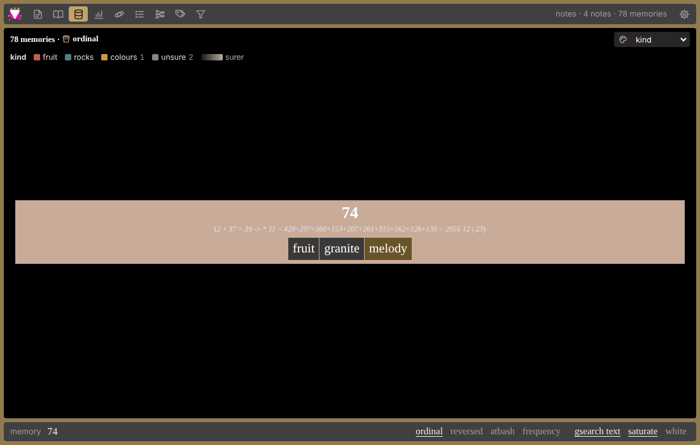
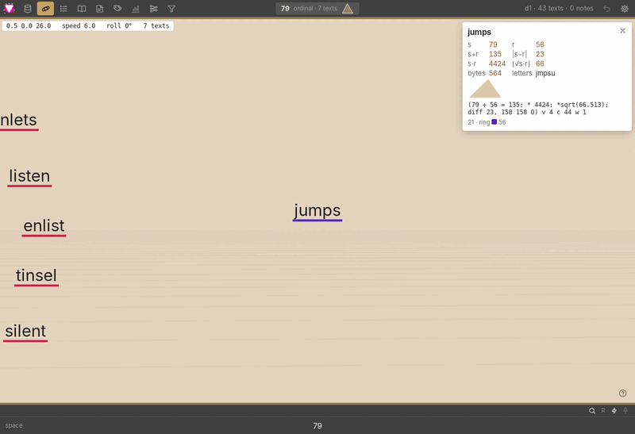
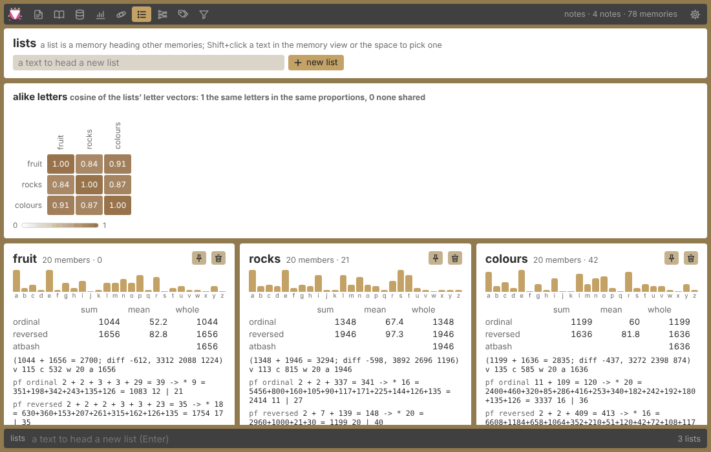
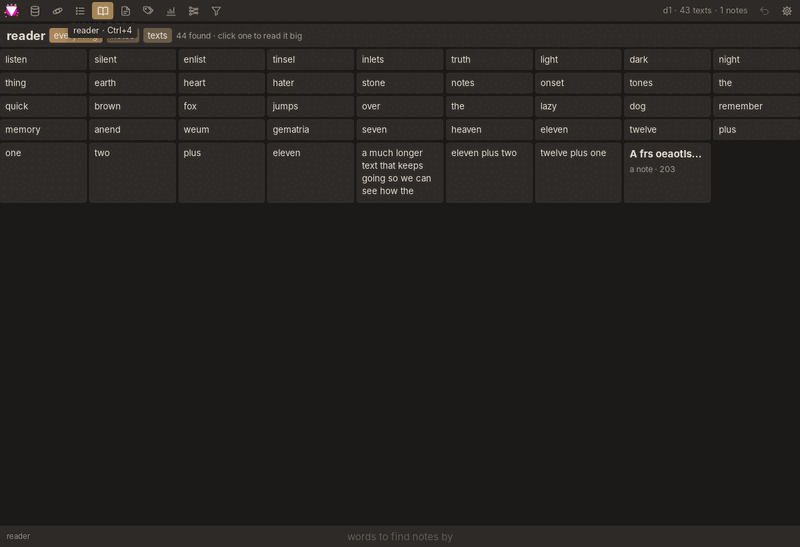
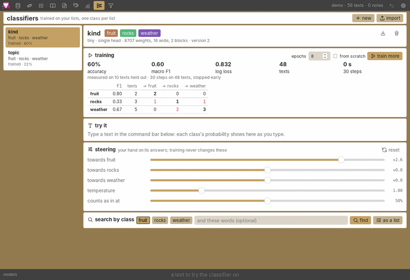
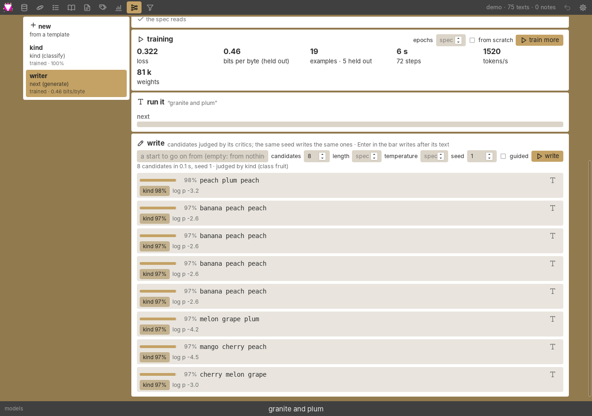
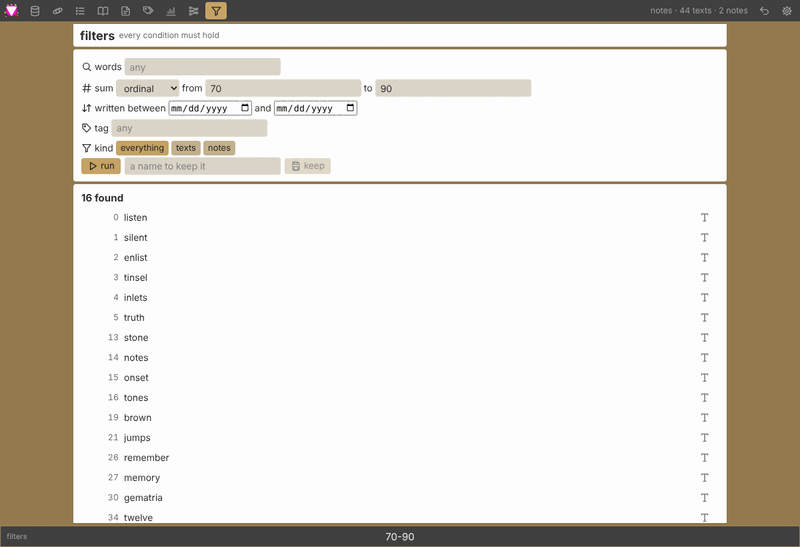
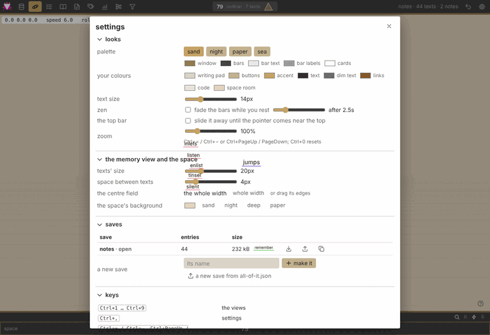

# The anend guide

What anend is, what each part of it does, and how to use it. For building it, running a
hub and the APIs, see the [README](../README.md).

## What anend is

anend is a notes app with a game inside it.

The **notes** side is plain: markdown notes with a `# title`, tags, a reader, and saves
you can swap between like a game's.

The **game** is a memory palace built on gematria. Every word or phrase you type has
sums, and texts that share a sum share a room:

| sum | how it counts | `plum` |
|---|---|---|
| **ordinal** | a=1, b=2 … z=26 | 62 |
| **reversed** | a=26, b=25 … z=1 | 46 |
| **frequency** | the letters themselves, sorted, so anagrams land together (`listen`, `silent` → `eilnst`) | `lmpu` |

You remember short texts, find what shares their sums (**gsearch**), fly through them in
a 3D room, and gather them into **lists**. Then you grow lists into **models**: small
transformers trained on your own lists, which you steer, correct with a yes or a no, and
describe as plain data when you want more than a classifier. They are deterministic (the
same save gives the same answers on any machine, to the last bit) and they are yours.

There are two ways to run it, the same app in each:

- **the desktop app** (`anend-app`): a window of its own, everything kept on your
  computer.
- **the web app**: the same views in a browser, served by a hub at `/app/`. With
  `anend-hub --local` the hub is just yours, on your own machine.

## Getting started

- **Desktop**: run `anend-app`. It opens the save you had last, or `main.redb` in your
  data folder (`~/.local/share/anend/saves` on Linux). `anend-app --save path.redb`
  opens (or starts) another file.
- **Web, for yourself**: `anend-hub --local`, then open <http://127.0.0.1:8080/app/>.
- **Web, on a shared hub**: open the hub, **join** and **log in**; the app keeps your
  saves on the hub, in a workspace of your own, within the hub's quota.

### The screen

- **The top bar**: the views as icons (hover for their names; **Ctrl+1** … **Ctrl+9**),
  the status line (the open save and its counts, or the last thing that happened), undo,
  and settings.
- **The command bar** at the bottom: one place to type, doing what the open view needs
  (its placeholder says what). Each view keeps its own text. **Enter** outside the bar
  goes to it, **Esc** leaves it, **↑ ↓** walk its history, **Ctrl+Z** / **Ctrl+Shift+Z**
  in it undo and redo typing.
- **Ctrl+Z** outside the bar takes back the latest action: a forget, an edit, a list
  change, a yes or no to a classifier.
- **Ctrl+=** / **Ctrl+−** zoom, **Ctrl+0** back to 100 %.

## The memory view

Weum's memory page: texts on a black field, worked from the command bar (**Ctrl+1**).

| type | press | what happens |
|---|---|---|
| a word or phrase | **Enter** | everything sharing its sum in the current bucket comes up (and the text is remembered when **saturate** is on) |
| a number | **Enter** | that sum's texts, with its prime-factor line |
| a text | **Ctrl+Enter** | gsearch its sum, remember it and show its key |
| a key like `0,12` | **Shift+Enter** | that one text |
| a key | **Delete** at the end of the bar | forget it |
| `Enlist`, `Delist`, `List`, `Unlist` | **Enter** | work on the picked list and candidate (see [lists](#lists)) |

Outside the bar: **O**, **R**, **F** pick the bucket (ordinal, reversed, frequency; **R**
toggles); **← →** gsearch the bar text's ordinal or reversed sum; **G** gsearch text (off:
Enter searches words instead), **S** saturate, **L** the sidecar's letters. The strip over
the bar holds the same toggles, the sidecar of the bar's sums (click one to gsearch it)
and the sum buckets.

On the texts: **click** puts one in the bar, **double-click** its key, **Shift+click**
makes it the list, **Ctrl+click** the candidate, **Alt+click** selects several (then pick
a list or type a tag for them all), **right-click** opens a menu (edit, tag, list,
candidate, key, forget), **Ctrl+right-click** gsearches ⌊√(ordinal·reversed)⌋. The menu
also says when the text was written and what kind it is (a link, an email address, a
number, a date, a name, a phrase, a sentence…), told by its pattern; when the guess is
wrong, pick the right one there and the save keeps it. Drag the
field's edges to make it wider or narrower.

**Colouring by a classifier**: the palette picker in the strip colours every text by its
top class (fainter when less sure, grey when in none), with a legend. With one picked,
**C** turns on its search: a class's name finds the texts it counts in that class, any
other text the texts it reads most like.

## The space

A room where a search spreads its bucket out in front of you (**Ctrl+2**): texts with the
same sum cluster, deeper the higher the sum. Type in the bar and press **Enter** as in the
memory view.

| | |
|---|---|
| right-drag | look around |
| **W A S D**, **Space** / **C**, **Q** / **E**, **Shift** | fly, up / down, roll, fast |
| **R** | level the horizon |
| arrow keys | hop to the nearest text that way |
| **F** | cluster by the reversed sum |
| **H** | help |

Hover a text for its card of numbers; click puts it in the bar and its triangle (sides
ordinal, reversed and ⌊√(s·r)⌋) in the top bar. Shift+click and Ctrl+click pick the list
and candidate. The room's colour is a setting.

## Lists

A **list** is a text heading other texts: `fruit` heading `apple`, `plum`, `cherry`.
Lists are how you tell anend what goes together, and what models learn from.

- **Making one**: in the lists view (**Ctrl+3**), type a new name and press Enter; or in
  the memory view, Shift+click a text to make it the list.
- **Filling it**: in the memory view or the space, Ctrl+click a text (the candidate) and
  type `Enlist`; or Alt+click several and put them in a list.
- **The lists view** shows every list as a tile; the bar finds lists by name. A list's
  page has its name (editable), its members a page at a time (edit them, or take one out)
  and its figures: its letters, its sums. Deleting a list takes two clicks; its members
  stay.

## Notes, the reader, tags and stats

- **Notes** (**Ctrl+5**): newest first on the left, the editor on the right. The first
  line, `# like this`, is the title; the rest is markdown; tags go in their box.
  **Ctrl+S** saves. The bar narrows the list by words. Deleting takes two clicks.
- **The reader** (**Ctrl+4**): notes and texts as cards, a page at a time. Click one (or
  Enter on it) to read it big; **← →** step through, **Esc** goes back.
- **Tags** (**Ctrl+6**): every tag with its count. Click picks one, Ctrl or Shift+click
  adds or drops it; **all** or **any** decides how several combine. The bar finds tags;
  Enter picks the first.
- **Stats** (**Ctrl+7**): entries, texts, notes, versions, edges, how the sums spread,
  lists and tags.

## Models

The models view (**Ctrl+8**) has two tabs: **classifiers** and **spec models**. Both
keep their models in the save (in a file beside it, `<save>.models`), so they go along
when a save is copied, renamed or bundled. Training runs on a thread of its own with a
progress bar and the loss drawn as a line; the app stays usable, and **cancel** stops it
without writing anything.

### Classifiers

A **classifier** reads a text and says which of your lists it belongs with: each list is
a class, its members the examples.

- **new**: a name, two or more lists (or one and a "none of them" list), a size (**tiny**
  trains in seconds, **compact** is the default, **small** and **base** learn more and
  take longer), whether a text can be in several classes at once, and whether to read the
  letters' values and word sums too (gematria inputs, off by default).
- **train**, with **epochs** and **from scratch**. Then its figures: **accuracy** (the
  share of held-out texts put in the right class), **macro F1** (precision and recall
  averaged over the classes, 1 is perfect), **log loss** (lower is better), and the
  **confusion** table (the truth down the side, its answer across the top).
- **try it**: type in the command bar and each class's probability shows as you type.
  ✓ and ✗ on a class teach it on the spot (a few small steps on that text); **Ctrl+Z**
  (after Esc leaves the bar) takes the latest one back exactly. **texts like this** lists
  the texts it reads most alike.
- **steering** is yours, and training never changes it: a **bias** per class, the
  **temperature** (above 1 less sure, below 1 more), and the **threshold** for counting a
  text in a class. The bias report says how much your steering moved its answers.
- **search** by class (most likely first, with ✓ and ✗ on each), write a class's texts
  into a **list** (`classifier: class`), and see the **verdicts** you gave.
- **export** writes it as a `.anendcls` file; **import** takes one in (each class goes
  to the list of its name, made when there's none). Delete takes two clicks.

### Spec models

A **spec model** is a model described as plain data ([the format](../docs/models.md)): what it
reads, how big it is, what comes out (classes, labels, numbers, or text it writes), what
it learns from in this save, and for a writer, which other models judge what it writes.

- **new** starts from a template, filled in with your lists: a **classifier** (one class
  of several), a **tagger** (any of several labels) or a **generator** (writes texts like a
  list's, judged by a trained classifier or spec model of the save when there is one).
  Edit it, then **make it**.
- **The spec** is a JSON editor. It's checked a beat after you stop typing: a broken rule
  shows under it with where it is (`heads[0].classes`, `data[1].class`), and unknown fields
  are named. **Ctrl+Enter** (or **save**) keeps it. Edits to the data, critics, sampling
  or training options keep its training; a change to its input, trunk, heads or seed
  means it trains anew.
- **training**: epochs (the spec's when left empty), from scratch, cancel, and the
  figures: loss, bits per byte for a writer (lower is better), each head's accuracy and
  confusion table when some examples were held out.
- **run it**: type in the command bar and every head answers as you type.
- **write** (a generator): candidates from a start (or from nothing), each with its
  critics' scores, best first; ones that break the spec's constraints come last, greyed.
  The same seed writes the same candidates. **Enter** in the command bar writes after the
  bar's text. **guided** steers each byte toward what the critics want (slower).

A spec can start from a pretrained open model (`"from": {"pretrained": "folder"}`); see
[models](../docs/models.md). On a shared hub only the folders the hub offers can be named.

## Filters

Filters (**Ctrl+9**) ask for texts by **words**, a **sum** in a range (ordinal or
reversed), when they were **written**, a **tag** and a **kind** (texts or notes); every
condition must hold. In the bar, a number (`79`) or a range (`70-90`) sets the sum, anything
else the words. **keep** saves a filter by name in the save; the kept ones are chips to
run again.

## Settings and saves

**Ctrl+,** or the gear. The sections fold, and remember it.

- **looks**: a palette to start from, then any colour by name; text size; zen (the bars
  fade while you rest); the top bar sliding away; zoom.
- **the memory view and the space**: the texts' size, the space between them, the centre
  field's width, the room's colour.
- **saves**: every save with its counts and size. **open**, **new**, **copy**, **rename**,
  **delete** (two clicks), a **backup** (its texts in one JSON, the rest in another), and
  **import** weum's `all-of-it.json` into the open save.
- **keys**: every shortcut.
- **the hub**: the hub's address (sharing from the app comes back here when the hub's
  sharing moves to the entry graph; for now share on the hub's site).

## The hub

A hub is anend's server: `anend-hub`. With `--local` it is your own web app's daemon, no
logins. Run for others, it's a website where people join, keep their saves in the web
app, and share saves and classifiers, with stars, points, levels and badges. Everything
shared waits for an admin unless you're trusted. Running one is in
[deploy](../docs/deploy.md).

## Glossary

| | |
|---|---|
| **text** (memory) | a short text kept in a save under a **key** (`0,12`) |
| **note** | a markdown document with a `# title` and tags |
| **ordinal / reversed** | gematria sums: a=1…z=26, a=26…z=1 |
| **frequency** | a text's letters sorted, so anagrams match |
| **bucket** | the sum a memory-view search uses |
| **gsearch** | finding every text that shares a sum with yours |
| **saturate** | remembering what you search |
| **list** | a text heading other texts; the **candidate** is the one about to join |
| **classifier** | a model trained on your lists, one class per list |
| **steering** | your hand on a classifier: bias, temperature, threshold |
| **spec model** | a model described as data: inputs, trunk, heads, data, critics |
| **head** | one output of a model: classes, labels, values, or the text it writes |
| **critic** | another model judging what a generator writes |
| **save** | one file of notes, texts, lists and tags, with its models beside it |
| **bundle** | a save as one JSON document, keys, classifiers and spec models and all |
| **hub** | anend's server: the web app and a site for sharing |
| **zen** | the bars fading while you rest |
